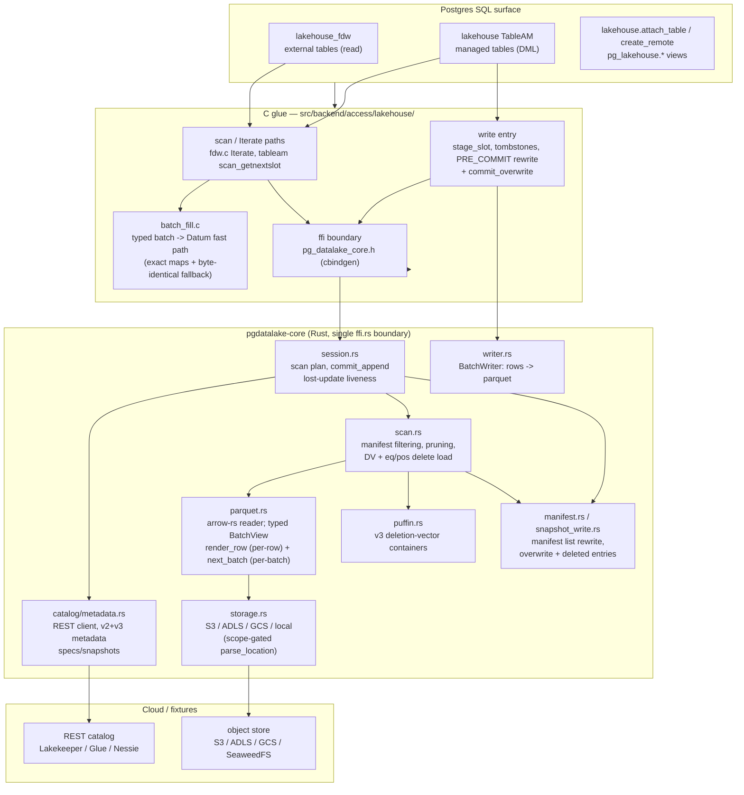
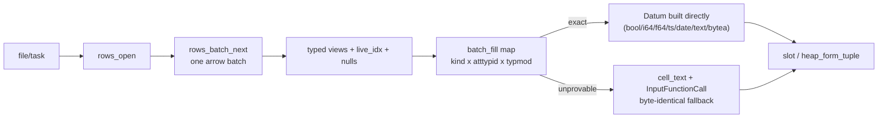
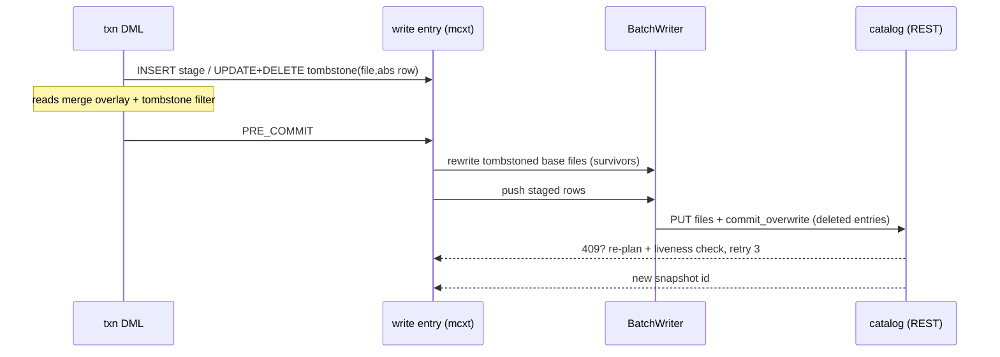

# 01 — Architecture

## 1. Two kinds of Iceberg tables, one core

```
                       ┌─────────────────────────────────────────────┐
                       │              PostgreSQL executor             │
                       └───────┬───────────────────────────┬─────────┘
                               │ TableAM API               │ FDW API
                ┌──────────────▼──────────────┐  ┌─────────▼──────────┐
                │  lakehouse TableAM (MANAGED)  │  │  lakehouse FDW     │
                │  src/backend/access/        │  │  (EXTERNAL attach) │
                │        iceberg/             │  │  contrib_iceberg/  │
                └──────────────┬──────────────┘  └─────────┬──────────┘
                               │        C ABI               │
                  ┌────────────▼────────────────────────────▼───────────┐
                  │        pgdatalake-core (Rust static library)         │
                  │  ┌────────────┐ ┌──────────────┐ ┌───────────────┐  │
                  │  │ catalog    │ │ metadata     │ │ file IO       │  │
                  │  │ clients    │ │ (spec model, │ │ S3/ADLS/GCS/  │  │
                  │  │ REST/Glue/ │ │  planning,   │ │ MinIO         │  │
                  │  │ Nessie/JDBC│ │  schema)     │ │ (object_store)│  │
                  │  └────────────┘ └──────────────┘ └───────────────┘  │
                  │  ┌──────────────────────────────────────────────┐   │
                  │  │ parquet read/write (arrow-rs + parquet crate)│   │
                  │  └──────────────────────────────────────────────┘   │
                  └─────────────────────────────────────────────────────┘
```

**Decision D1 — single Rust core, two Postgres faces.**
*(Naming amended 2026-11-19: the core is `pgdatalake-core` and the SQL surface
(`lakehouse` schema/extension/TableAM) is format-generic, so Delta, Parquet,
Avro and engine integrations (DataFusion, Polars) can reuse it; Iceberg is the
first FORMAT value, not the product name. Iceberg-specific behavior below still
describes the Iceberg format layer — other formats add sibling drivers.)*

- **Managed tables** use a **Table Access Method** (`lakehouse` AM, registered like
  `heap` in `pg_am`, handler `lakehouse_tableam_handler()`). This gives native
  `CREATE TABLE … USING lakehouse FORMAT iceberg`, full DML through `ExecInsert/ExecUpdate/…` entry
  points, parallel scans, and TTS slots.
- **External tables** use an **FDW** (`lakehouse_fdw`) because the table is owned by an
  external catalog: lifecycle (`CREATE/DROP`) belongs to the catalog, not to
  `pg_class`. The FDW shares 100% of the core (same catalog client, same scan
  planner, same writer) with the TableAM. `Import Foreign Schema` maps namespaces.

Both faces call the same C-ABI functions; the difference is only lifecycle and
ownership. This prevents the classic two-implementation drift (see pg_lake/pxf in
[11-related-work.md](11-related-work.md)).

**Decision D2 — Rust core as a static library, not a loadable "engine".**
`pgdatalake-core` compiles with `cargo build --release` into `libpgdatalake_core.a`
(+ generated `pg_datalake_core.h` via `cbindgen`) and is linked into the `lakehouse`
and `lakehouse_fdw` modules. Rationale:

- arrow-rs/parquet and object_store are the highest-quality Iceberg-adjacent code
  available; rewriting in C is months of risk for zero user value.
- Rust-ABI stability is managed by *us* at the C boundary: opaque handles
  (`PGDatalakeCatalog`, `PGDatalakeScan`, `PGDatalakeWriter`), `#[repr(C)]` structs,
  no Rust types crossing the boundary, all fallible calls return error strings that
  the C side converts with `ereport(ERROR, …)`.
- Static linking keeps the fork a normal postgres build (no extra runtime deps),
  keeps `meson` integration to one custom step (`rust_build.py`), and the library
  is built by CI *before* configure, same pattern as `--with-llvm` bitcode.

Alternatives considered and rejected in [11-related-work.md](11-related-work.md):
embedding DuckDB (license/perf/fork-weight), Arrow C++ (build-system weight,
exception-safety across `ereport`).

## 1a. Component map (whole-system view, 2026-11-20)

*(Mermaid renders on GitHub; module names are the real ones in the tree —
Rust under `src/backend/access/lakehouse/core/pgdatalake-core/src/`, C
under `src/backend/access/lakehouse/`. A current file-by-file source map,
the end-to-end read paths, snapshot rules and a troubleshooting playbook
live in [`src/backend/access/lakehouse/README.md`](../../src/backend/access/lakehouse/README.md)
— that map supersedes this section where the tree has grown since
2026-11-20, e.g. `managed_count.c`, `managed_credentials.c`,
`managed_send.c`, `managed_lookup.c` and the `fdw_plan`/`fdw_exec` split.)*



**Read hot path** (M3-R1 — the measured 3.2x):



**Write path (COW, slice 28):**



## 2. Layer responsibilities


### Layer 1 — `pgdatalake-core` (Rust)
- **Catalog clients**: REST (v1 spec: `GET /v1/config`, `loadTable`, `createTable`,
  `commitTable`, OAuth2 client-credentials token refresh), AWS Glue, Nessie,
  Polaris/Unity (both are REST-superset profiles), JDBC catalog (via direct PG/MySQL
  protocol or through `postgres_fdw`-independent libpq embedded? — no: JDBC catalog
  support is deferred; REST covers Polaris/Unity/Nessie REST profiles, Glue covers
  AWS, see [03-catalog.md](03-catalog.md)).
- **Metadata model**: full Iceberg spec types (`TableMetadata`, `Schema`,
  `Snapshot`, `ManifestList`, `Manifest`, partition specs, sort orders, v3
  deletion vectors), serde both directions, version negotiation v1→v3.
- **Scan planning**: snapshot selection → manifest filtering (partition predicates,
  metrics pruning) → task list of (data file, delete files) with residual
  expressions.
- **File IO** over `object_store` crate: S3 (incl. MinIO/endpoint override), ADLS
  Gen2 (`abfss://`), GCS; credential chains per [09-security.md](09-security.md).
- **Parquet**: read via arrow-rs `ParquetRecordBatchReader` (projection, row-group
  pruning by statistics, page-level pushdown), write via
  `ParquetWriter` with configurable compression (zstd default), target file size,
  row-group size, and v3 deletion-vector writes (Puffin blobs).
- **Expression model**: translate a small post-Pushdown-safe expression tree
  (Iceberg `Expression` subset) from C, evaluate residuals in Postgres.

### Layer 2 — C glue, `src/backend/access/lakehouse/`
```
src/backend/access/lakehouse/
  lakehouse.c            AM handler, TableAmRoutine implementation
  scan.c               table_beginscan/parallel scan, slot fill from batches
  insert.c             INSERT: batch accumulator → Parquet file → commit
  update.c             UPDATE/DELETE: copy-on-write or merge-on-read strategy
  merge.c              MERGE (rewrite-driven v1)
  catalog.c            catalog handle cache (per-RelOptInfo), relcache hooks
  snapcache.c          statement-scoped snapshot pinning, MVCC-enumerator
  ddl.c                CREATE/ALTER/DROP TABLE USING lakehouse FORMAT iceberg, attach/detach
  analyze.c            ANALYZE via Parquet metadata + sampling
  maintenance.c        bgworker: compaction, snapshot expiry, orphan cleanup
  rest_view.c          pg_lakehouse.* metadata views
src/include/access/iceberg/
  iceberg_core.h       cbindgen-generated FFI header (checked-in stable copy)
  iceberg_am.h         internal AM structures
```

### Layer 3 — `contrib/lakehouse_fdw/`
FDW face for external tables; mostly thin: `PlanForeignScan` reuses the same scan
planner, `ExecForeignInsert/Update/Delete` reuses the writer. Ships with
`lakehouse_import()` for `IMPORT FOREIGN SCHEMA`.

### Layer 4 — minimal core patches (allowlist, see RULES.md)
| Patch | Why it cannot be an extension | Risk |
|---|---|---|
| register `lakehouse` AM in `pg_am` bootstrap catalog | bootstrap row + catversion bump | low |
| `DEFAULT_TABLE_ACCESS_METHOD` accepts AM from GUC enum + `lakehouse` option in `CREATE TABLE` parse | grammar is core | low |
| reloptions parse hook for `location` / `catalog` / `format_version` | relopt registration is process-global init in core | low |
| autovacuum dispatch: let AM declare "maintenace" instead of vacuum/analyze | `autovacuum.c` AM check | medium |
| `smgr`-less relation creation: allow rels without relfilenode but with `reltablespace=0` + AM flag | storage.c asserts | medium |
| `ExtendAGUC`: new GUC class `lakehouse.*` | trivial | low |

Everything else (executor, WAL, recovery, catalogs) is untouched. In particular
**the fork does not change the WAL format**; Iceberg tables are WAL-free for data
(catalog rows still WAL-protected as usual) — see [07-transactions.md](07-transactions.md).

## 3. Managed-table lifecycle

1. `CREATE TABLE … USING lakehouse FORMAT iceberg` → AM handler validates `location`/`catalog`
   reloptions → core `createTable` on the catalog → catalog row in `pg_class`
   (`relam = lakehouse`, no `relfilenode`) + a new catalog `pg_lakehouse_table`
   (OID → catalog identity, snapshot pointer cache, last maintenance times).
2. DML → writers accumulate Arrow batches in memory up to `target_file_size`
   (default 128 MiB) → per (sub)transaction: write data files → `commitTable`
   (optimistic, retry per [07-transactions.md](07-transactions.md)) → files become
   visible only via the snapshot commit (atomic rename-equivalent).
3. Crash before commit → orphan files; the orphan cleaner reclaims them after a
   grace window. Crash after commit but before local catalog update → next
   relcache refresh reconciles from the remote catalog (remote is source of truth).

## 4. Relationship to upstream surface

- `EXPLAIN` shows Iceberg-specific nodes (`Iceberg Scan` with files/tasks/row-group
  pruning counts, delete-file strategy, snapshot id).
- `\d+` shows table kind (`managed`/`external`), catalog name, location, current
  snapshot, partition spec.
- New schema `pg_lakehouse` with views: `catalogs`, `snapshots`, `files`, `manifests`,
  `partitions`, `refs` (branches/tags), `history`.
- Functions: `lakehouse.snapshot_of(regclass)`, `lakehouse.branch_of(regclass)`,
  `lakehouse.rewrite_data_files(regclass, …)`, `lakehouse.expire_snapshots(regclass, …)`,
  `lakehouse.remove_orphan_files(regclass, dry_run bool)`.

## 5. Build integration

- `meson.build` gains an optional feature `-Ddatalake=enabled`
  (default `auto`): runs `cargo build --release -p pgdatalake-core` via
  `src/backend/access/lakehouse/rust_build.py`, then links `libpgdatalake_core.a`.
- Upstream purity: the entire feature is *additive* except for the allowlist patches
  in §2 Layer 4 — each allowlist patch is a separate, minimal commit marked
  `[core-allowlist]` so upstream PRs can be extracted individually.
- Dependency pinning lives in `specs/lakehouse/Cargo.lock.reference` until the Rust
  workspace is created in M1.
