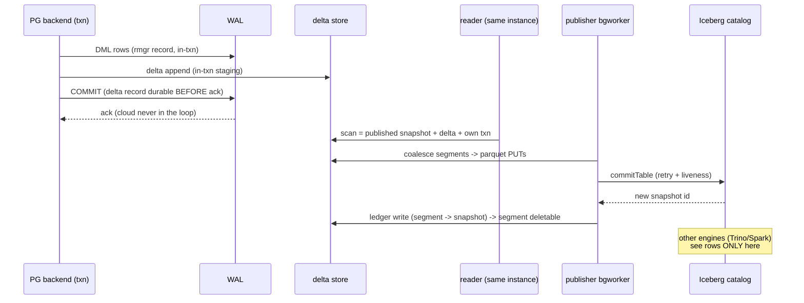
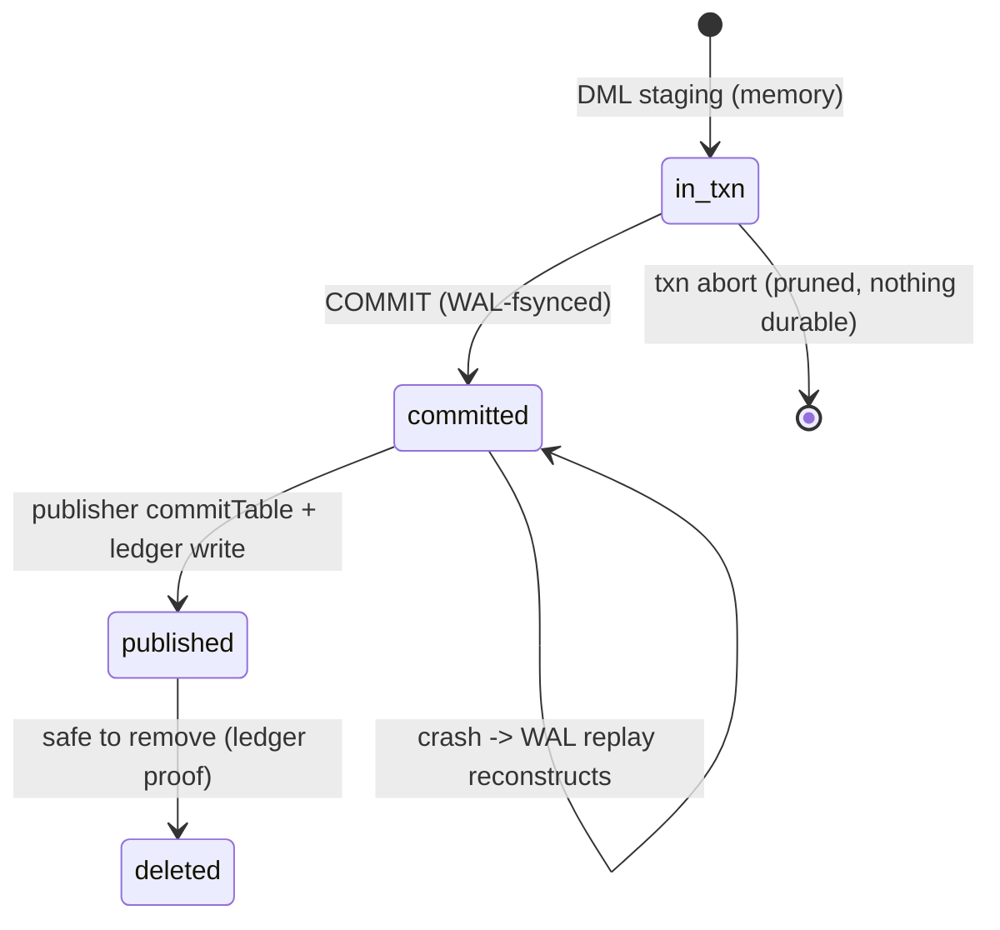

# 15 — Staged Writes (Delta + WAL Durability), Background Compaction, and Caching

*(2026-11-20. SPEC-ONLY by direction: design and cross-review now,
implementation deferred. Motivation: M2's per-transaction COW commit
forces every UPDATE/DELETE to rewrite base files synchronously and every
commit to make remote PUTs — correct, but it caps write throughput,
manufactures small files, and pins commit latency to the cloud RTT.
This doc specifies a durable staged-delta layer between PG commits and
Iceberg commits, a background compaction/publish thread, and a read
caching tier — deliberately exploiting Postgres' stability (WAL
machinery, crash recovery, physical replication, buffer management)
instead of rebuilding it in the storage layer.)*

## 1. Problem statement and goals

Today (docs 06 §3, 07 §2): each committing transaction pushes its staged
rows and COW rewrites to object storage, builds a snapshot, and commits
to the REST catalog **synchronously inside PRE_COMMIT**. Consequences:

| # | Symptom | Root cause |
|---|---|---|
| P1 | Small-file proliferation | one file-set per transaction (doc 08 small-file trigger already fires at n_inserted_batches ratio 0.5) |
| P2 | Write latency = cloud latency | S3 PUT + manifest/list write + REST commitTable in every commit |
| P3 | Write amplification | every UPDATE/DELETE rewrites its base file (COW), even for single-row DML |
| P4 | Bursty PUT volume | concurrent backends PUT independently; no coalescing |
| P5 | Cold reads | every scan GETs metadata + parquet bytes; nothing exploits temporal locality |

**Goals.** G1: commit latency decoupled from remote publish (bounded,
measurable). G2: durable through PG crash (WAL-grade: committed DML is
never lost or half-visible). G3: coalesced, size-bounded file emission
(small-file problem prevented, not just repaired). G4: reads merge
unpublished deltas correctly — never misread (doc 14's governing
principle applies to the delta layer too). G5: other engines' visibility
lag is explicit and operator-controlled, never silent-forever. G6:
caching layers that are safe *because of* Iceberg immutability, with no
invalidation-on-write machinery at all.

**Non-goals.** Cross-engine concurrent delta visibility (publish closes
the gap); transactional guarantees beyond PG's own for the delta;
replacing PG WAL for PG-native objects; write path for external tables
(unchanged: FDW reads only).

## 2. Architecture overview

Four cooperating pieces, layered so each is independently shippable:

```
         ┌────────────────────────────────────────────────────┐
SQL DML →│ A. Staged-delta layer (per-table durable delta)    │  ← PG commit is
commit → │    WAL-logged via a custom resource manager        │    now fsync-WAL
         ├────────────────────────────────────────────────────┤    cheap + local
         │ B. Publisher thread (dynamic bgworker, per table)  │  → Iceberg:
         │    coalesces deltas → files/DVs → REST commitTable │    async, batched
         ├────────────────────────────────────────────────────┤
         │ C. Compaction thread (doc 08 lakehouse.optimize    │  → rewrite-based
         │    exec mode, run as a service)                    │    maintenance
         ├────────────────────────────────────────────────────┤
reads →  │ D. Read path: buffer cache → local block cache →   │  ← immutable-
         │    object store (existing scan pipeline)           │    path caching
         └────────────────────────────────────────────────────┘
```

A is the foundation; B depends on A; C is doc 08's already-designed
optimizer running continuously instead of on-demand; D is additive.

**Commit → visibility timeline (staged INSERT mode):**



## 3. A — the staged-delta layer

### 3.1 Representation

Per managed table, an in-instance **delta** logically partitioned by
commit: `{inserted rows, tombstoned (file, row-pos) pairs}`. Content is
exactly what slice 28 already accumulates in memory (LakehouseWriteEntry
staged_values + tomb_files) — this slice generalizes it from
transaction-lifetime to committed-but-unpublished lifetime, and makes it
durable.

Row encoding reuses the writer's row-JSON (write path, doc 06 §4) — the
publisher must re-encode only once, at file emission; the delta stays
typed-binary (the staged accumulator's existing representation) so
re-reads never re-parse text.

### 3.2 Durability: a custom WAL resource manager (the load-bearing decision)

**Decision D1.** Delta records go through **Postgres WAL via a custom
resource manager (RM_LAKEHOUSE_ID)**, not a bespoke sidecar log.

- A commit that staged N rows / T tombstones emits one delta WAL record
  (rmgr ID from the core-allowlist rmgr table — the only core-adjacent
  edit; feasibility pre-checked: `RmgrIds` reserve a slot for extensions
  via RM_MAX_ID, custom rmgrs are a supported custom-WAL facility in
  the resource-manager lineup of this tree).
- PG's existing commit machinery then provides, for free, exactly what
  a hand-rolled WAL would have to re-earn: **fsync-at-commit ordering**
  (the delta is durable before COMMIT acks), **crash recovery** (startup
  replay reconstructs every unpublished delta — G2), **physical
  replication** (standbys replay deltas, so a promoted standby inherits
  the delta — no operator procedure), and **PITR** (restore point
  includes staged state).
- Records larger than `XLogRecordMaxSize` chunk (records are chunked by
  XLogInsert machinery; the redo function reassembles — same contract
  bulk WAL records already follow).
- **Redo semantics:** replay appends the delta to the on-disk delta
  store (§3.3). Undo does not exist (deltas are never rolled back; the
  transaction's own abort never wrote one — abort still prunes in-memory
  staged state exactly as today).

**Rejected alternative (recorded):** sidecar fsync'd log per table in
PGDATA. Rejected because it re-implements replay, replication shipping,
and fsync ordering that PG gives free; risks divergence between the
sidecar and WAL during crash-recovery edge cases; and adds a second
durability surface to secure (RULES §6: the sidecar would carry row
data, not credentials — but it still must not escape backup tooling).

**Explicit consequence (visibility, G5):** after COMMIT, other engines
(Trino, Spark) do NOT see the rows until the publisher commits an
Iceberg snapshot. PG sees them immediately (delta read-through, §3.4).
This is a real semantic change vs doc 07 §2's "commit includes remote
commit" and is gated on it: §7 requires it be opt-in per table
(`lakehouse.write_mode = 'staged'`, default remains 'cow') until the
whole doc is implemented and lived with.

### 3.3 Delta store

On-disk location: per-table directory under the instance's data
directory (`pg_lakehouse/delta/<relid>/segment-<uuid>`), managed like
PG's own durable state (fsync'd, included in basebackup). Segment = the
delta produced by one or more commits, flushed by the publisher (§4).
Committed-but-unpublished segments are enumerated at startup from a
small fsync'd index (rebuilt from WAL replay, which is authoritative).

Retention: a segment dies only when the publisher has durably recorded
its Iceberg commit result (the published-snapshot-id ledger, §4.3).
Publish is idempotent and at-least-once at this layer; §4.4 makes
duplicate publish harmless.

**Segment lifecycle:**



### 3.4 Read-your-writes through the delta

The existing own-writes overlay (tableam scan: staged rows served in
loop after drain, tombstone filter per file) generalizes: the scan
merges (a) the current published snapshot, (b) unpublished delta
segments, (c) the transaction's own uncommitted staging — in that
order, tombstones applying from all three. Because tombstones are
(file, absolute-row) against a pinned snapshot (the doc-14 V2 lesson:
identity must be snapshot-scoped), the scan pins its snapshot exactly as
today; delta merges are append-only and cannot disturb file identity.

FDW external tables are unaffected (they never write).

### 3.5 What may be staged (scoping decision D2 — the rigor cross-check)

Deferred publish is **safety-critical for rewrites**. Append-only
publishes are trivially commutative (new manifest entries can be added
on top of ANY base; conflict retry just re-plans). COW rewrites are
NOT: a tombstone is position-based against a base file that a competing
publisher may have replaced (slice 28's lost-update liveness check
would fire *after* the transaction already acked — an unacceptable
error surface).

Therefore:

| DML | Staged (deferred publish) | Reason |
|---|---|---|
| INSERT | **yes** | appends commute; publish conflict = retry with fresh base |
| DELETE/UPDATE (COW) | **no — synchronous COW commit as today (doc 07 §2)** initially | position-tombstones demand base-file liveness at commit time; deferring moves lost-update discovery past the ack |
| DELETE/UPDATE via DV (doc 14 V3, merge-on-read) | **yes** (second phase) | DV blobs are also file-scoped but their publish is ADDITIVE (delete-file manifest entry), same commutativity as appends; the V3 machinery lands first |
| MERGE | decomposes per doc 07 §3 → follows the two rows above |

Consequence: staged mode's biggest win (INSERT throughput, P1/P2/P4 for
bulk loads) lands first with the least semantic risk; UPDATE/DELETE
coalescing arrives with V3 DVs, where the publisher can merge MANY
transactions' tombstones into ONE rewrite (P3 amortization: the batched
COW rewrite that today runs per transaction).

## 4. B — the publisher thread

### 4.1 Shape

One **dynamic background worker** (per instance; leases tables via a
shared-memory work queue, 13-review #7's lesson: per-table, never a
process global). Wake triggers: (a) delta bytes/rows above threshold,
(b) age of oldest unpublished segment above `lakehouse.publish_max_lag`
(default 30s, operator-tunable — the G5 knob), (c) idle (quiesce:
publish anything left, then park).

### 4.2 Emission (small-file prevention, G3)

The publisher coalesces across segments into file emissions bounded by
`lakehouse.target_file_size` (doc 08's bin-pack target — SAME knob,
prevention and repair share policy). It writes N coalesced parquet
files, builds ONE manifest + list, and commits ONE snapshot per cycle
(appends during staged mode; DV delete-files in the V3 phase). PUT
volume per DML drops from O(transactions) to O(publish cycles); the
SeaweedFS/S3 intermittently-flaky PUT behavior (observed since M2)
is absorbed by bounded retry inside the publisher, off the transaction
path.

### 4.3 The published-snapshot ledger

After a successful commitTable, the publisher records
`(segment-id → published snapshot-id)` in an fsync'd ledger file (same
durability class as the delta index). Startup treats "in ledger" as
"safe to delete segment". Crash windows:

| Crash | State | Recovery |
|---|---|---|
| before PUTs complete | segment unpublished, nothing remote | replay delta; publish later |
| after PUTs, before commitTable | orphan objects, no snapshot | publisher retries commitTable with fresh plan; orphan PUTs are unreferenced (doc 08's orphan rule: provable-unreachability or age-based GC, never eager) |
| after commitTable, before ledger write | snapshot exists, ledger stale | publish attempt re-runs; §4.4 makes the retry a no-op or an additive re-publish (duplicate rows impossible: segments carry deterministic row provenance — see §4.4) |

### 4.4 Idempotency law

Publish of a segment must be **idempotent-or-additive**, never
duplicating rows. Mechanism: each segment's rows are emitted as one
data file whose manifest entry carries the segment-id in a summary
key; before emitting, the publisher checks the table's published-ledger
and existing snapshot summaries for that segment-id. If found: mark
published, delete local segment, done. If not: emit. Concurrent
publisher protection: a per-table advisory lock (pg_try_advisory_lock)
plus the REST catalog's own serializability (a second committer gets
409 and re-plans; the retry path re-checks the ledger).

### 4.5 Semantics impact on doc 07 (recorded as spec amendments once implemented)

- §2 commit protocol gains a staged variant: commit = WAL fsync +
  in-memory visibility; remote commit moves to the publisher. The
  AssertRefSnapshotId conflict check moves with it (append retry-safe).
- RR/SERIALIZABLE conflict semantics (M3): unchanged for reads; write-
  write conflicts between two PG transactions remain PG's own (no
  remote round-trip was ever involved pre-commit).
- Time travel: unpublished deltas are NOT time-travel-addressable
  (they are not snapshots yet) — documented: `FOR TIMESTAMP/VERSION`
  sees published state only.

## 5. C — background compaction (doc 08's optimizer as a service)

Doc 08 already specifies `lakehouse.optimize` (analyze/plan/exec),
bin-pack + sort + delete-application, minor/major tiers, snapshot
isolation, optimistic commit. This doc adds the **always-on trigger
layer** and the adaptive policy, not a new executor:

- Runs in the publisher worker's spare cycles (same process model, one
  worker class), or as a second worker when publish pressure is low.
- **Qualifying criteria v1 (rule-based, all measured, off by default
  until validated):**
  | Signal | Threshold (initial) | Action |
  |---|---|---|
  | small-file ratio (doc 08) | > 0.5 | bin-pack minor compaction |
  | deleted-record fraction per file | > 20% | rewrite (apply deletes) |
  | file count per table | > 2× target count | bin-pack |
  | unreferenced-object age | > GC grace (doc 08) | orphan GC (proof-first) |
- **Adaptive policy (the "ML" ask, scoped honestly):** v2 learns
  per-table write burstiness, DML mix, and compaction cost/benefit from
  the stats the optimizer's analyze mode already collects (cardinality,
  skew, layout correlation, file counts) and tunes the thresholds per
  table — a feedback controller over measured quantities, not a model
  guessing them. Any fancier model (predicting access patterns for
  pre-compaction/clustering) is explicitly OUT of scope until v1
  thresholds are validated against real workloads — recorded so the
  "ML-based" ambition stays honest and reviewable.
- Safety inherits doc 08 in full: snapshot isolation, optimistic commit,
  never removes objects without proven unreachability, observable
  outcomes in exec mode.

## 6. D — read caching

### 6.1 Layer 0: what PG already does

Buffer management, temp-buffer churn, planner caching stay untouched.
The lakehouse layer adds:

### 6.2 Layer 1: immutable-bytes block cache (the big win, and the safe one)

**Decision D3.** Cache keyed by **(storage path, byte range)** with
**capacity-based eviction only — no invalidation path exists**, because
Iceberg data/manifest file paths are immutable (a rewrite produces a
NEW path). This is the structural reason caching here is safe where
caching a mutable store is not: a cached byte range for path P is
correct for P forever.

- Scope: parquet data + puffin + avro metadata/manifest bytes fetched
  by `storage.rs get_bytes/ranged reads` (13-review #2's ranged reads
  are the prerequisite — implemented first if absent at build time).
- Location: configurable directory (local NVMe / EBS gp3 volume),
  size-capped (LRU), O_DIRECT-friendly contiguous extents; per-instance
  (never shared across catalogs/warehouses — a path is only unique
  within its warehouse; the cache namespace includes the warehouse id).
- Security: cache files carry table DATA (RULES §6 class): directory
  perms 0700, lives in PGDATA or operator-specified secure path, never
  included in dumps; contents never logged.
- Effect: repeat reads and multi-worker scans of the same table become
  local-disk speed; this is where "frequently accessed data" wins come
  from, and it composes with compaction (post-compaction cold files
  repopulate the cache on first touch).

### 6.3 Layer 2: metadata cache

Catalog metadata.json / manifest lists / manifests per snapshot-id
(immutable per snapshot) — same law as 6.2. Today every scan re-GETs
them (13-review perf #1's EXPLAIN GETs); the cache makes repeated
EXPLAIN/LIMIT genuinely GET-free under the default policy.

### 6.4 Layer 3: result cache (explicitly LAST, and smaller than it sounds)

A per-instance result cache (query → rows) is only sound when keyed by
(query identity, pinned snapshot id, catalog state), and PG's executor
caches nothing cross-statement by default for good reason. Scope it to:
prepared-statement-level reuse of scan results for repeated identical
scans of a pinned snapshot, capped by memory, invalidated by ANY new
published snapshot on the table (cheap check: snapshot id compare).
If the invalidation cost or staleness risk outstrips the benefit in
measurement, this layer is dropped — recorded here so the ambition
doesn't silently become a correctness hazard.

## 7. Rollout ordering (each step independently shippable + revertible)

1. **Ranged reads + metadata cache (6.2/6.3)** — pure win, no semantics.
   (Depends on 13-review #2's bounded memory work landing first.)
2. **Staged INSERT mode (§3, §4)** behind `lakehouse.write_mode =
   'staged'`, appends only, off by default; docs 06/07/08 amended in
   the same commit per the binding rules.
3. **V3 DV write mode (doc 14)** — prerequisite for staged DML.
4. **Staged DELETE/UPDATE via DVs + publisher-merged rewrites** (P3
   amortization).
5. **Compaction-as-a-service (§5)** — thresholds only; adaptive policy
   once thresholds are validated.
6. **Result cache (6.4)** — only if measured worthwhile.

## 8. Open questions (decisions owed before implementation)

- Q1: does the standby replay of delta records (free with D1) become a
  supported read path, or are standby lakehouse reads gated to
  published-only state in v1? (Recommend: published-only; delta reads
  on standbys arrive after primary semantics are stable.)
- Q2: delta storage placement for huge bursts (spill to tablespace?
  compress segments? cap per-table delta size and force publish?).
  Recommend: size cap + forced publish; compression only if measured.
- Q3: interaction with `lakehouse.attach_table` re-attach / identity
  change while unpublished deltas exist (recommend: forbid — same
  two-phase rule as doc 07's PREPARE).
- Q4: does staged mode apply to partitioned managed tables' emission
  (doc 08 partition transforms) in the publisher, or does staged mode
  v1 restrict to unpartitioned? (Recommend: unpartitioned first, keep
  the emission code identical to today's writer.)

## 9. Cross-references

- Doc 00 — goal #4 (writes as fast as local tables): G1/G3 serve it.
- Doc 01 §architecture — writer pipeline: the staged accumulator (doc
  06 §4) becomes the delta source; no new encoding.
- Doc 02 — `lakehouse.write_mode` gains 'staged' alongside doc 14 V3's
  'merge_on_read'; publish lag is a new server/table option.
- Doc 03 §5 — fail-fast: publisher failures surface in the ledger and
  logs, not in DML acks (the one place errors intentionally do NOT
  fail fast is the deferred publish; every other path keeps it).
- Doc 04 — storage layer: ranged reads prerequisite; block cache lives
  behind StorageIo.
- Doc 05 — no type changes; delta stores typed rows.
- Doc 06 §3/§4 — write path: staged mode is a third row in the
  delete-mode matrix (append-deferred); batch accumulator persists.
- Doc 07 §2/§3 — commit protocol amendments (§4.5); MERGE decomposition
  unchanged.
- Doc 08 — optimize: this doc adds the trigger layer + adaptive policy
  to its already-designed analyze/plan/exec.
- Doc 09 — security: rmgr WAL records carry row data (WAL already
  carries row data); cache directory rules (§6.2); no new credential
  surfaces (credentials stay in user mappings, publisher uses the
  attach row's server/user-mapping — the postgres_fdw model).
- Doc 10 — testing additions: crash-point fuzz for the publish window
  (§4.3 table becomes acceptance cases); G5 lag measured in the perf
  gate; cache correctness = byte-identity tests vs direct reads.
- Doc 12 — M4 compaction items point here for the always-on layer;
  M3's MVCC/conflict work is unaffected (D2 keeps remote conflicts out
  of the transaction path).
- Doc 14 — V3 (DV write mode) is the gate for staged DML (§3.5); doc
  14's never-misread principle extends to delta merging (§3.4).
- Doc 13 — perf #3's writer half (flush thresholds, spillable overlay)
  is subsumed by §3/§4; perf #1's GET-count goals are served by 6.3.
