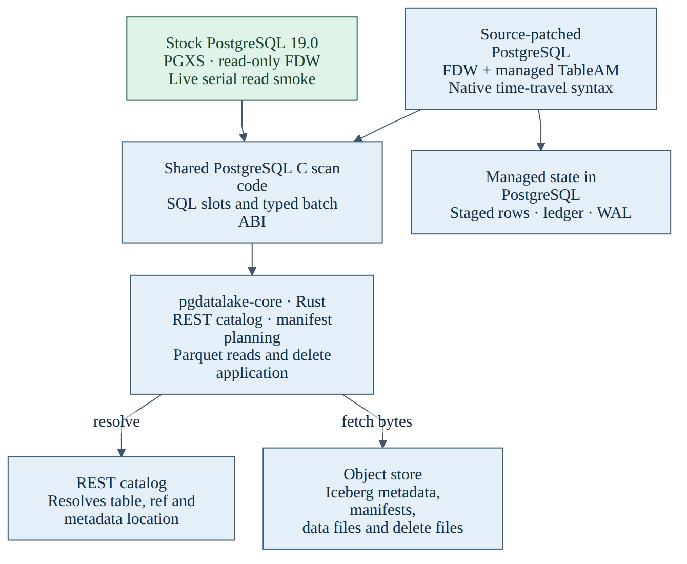

# Anvai Lake core product and publication contract

Anvai Lake has two public database packages. The stock PG19.0 pilot
attaches existing published Iceberg tables through a read-only FDW.
The fork adds native SQL syntax and a managed TableAM. The managed
fixture proves one-shot publication recovery after a lost reply,
compatible-pin bound reads and eligible COUNT on the same cut.
Provider retention, checked-role admission and hosted qualification
remain open. [Stock build and smoke](../../src/backend/access/lakehouse/stock/README.md) ·
[Current evidence and release gates](20-foundation-audit.md)

## Two packages, one shared reader



The Rust crate owns catalog, file and batch operations. PostgreSQL C owns SQL planning/execution, the managed transaction hooks and worker orchestration. PostgreSQL extension SQL defines the durable ledger and its fenced transitions. An external engine can publish a new snapshot through the same catalog. A reader holding the older pin continues to see the older rows. [Shared Rust crate](../../src/backend/access/lakehouse/core/pgdatalake-core) · [Fork worker](../../src/backend/access/lakehouse/publisher.c) · [SQL transitions](modules/04a-publisher-recovery.md)

| What a developer can rely on | Evidence at this revision | Gate still open |
|---|---|---|
| Published reads on stock PG19.0 | The Linux x86-64 PGXS smoke installs `lakehouse` version `1.0-fdw`. Trino inserts `[10,20,20,30]` and deletes one copy of 20. PostgreSQL and Trino agree on both pins, including after schema-only restore in PostgreSQL. An unpinned prepared query follows the changed ref. Foreign INSERT, UPDATE and DELETE are refused. [Live fixture](../../src/test/lakehouse/fixtures/stock-fdw-check.py) | One serial Lakekeeper / SeaweedFS / Iceberg v2 position-delete profile. Spark, equality deletes, v3 deletion vectors and real cloud stores each need their own package/profile evidence. |
| Reader features shared in source | Typed batches, file pruning, cached ranged reads and lazy projected decoding exist. Fork and Rust fixtures separately exercise v2 position/equality deletes and v3 Puffin deletion-vector reads. The fork has native time-travel syntax and stored-query deparse. The stock selector is the foreign-table option `snapshot_id`. [Reader](modules/02-iceberg-reader.md) · [V3 evidence](14-v3-conformance.md) | Full-column memory bounds, cross-worker pin identity under ref movement and latency distributions. A format fixture establishes the tested representation only. |
| Fork correctness guards | Managed COUNT recomputes at execution, rechecks SELECT and can fall back for RLS, inheritance or published segments. SQL regression covers prepared reuse, permission denial, rollback and capture across 65 staged relations. The COW guard refuses UPDATE/DELETE of a delete-bearing source with `0A000`; the qualified direct COW profile (UPDATE/DELETE of published rows) is boundary-tested (#94). [COUNT regression](../../src/test/regress/lakehouse/sql/count_elision.sql) · [COW smoke](../../src/test/lakehouse/fixtures/cow-delete-guard.sh) · [Boundary fixture](../../src/test/lakehouse/fixtures/cow-boundary-check.py) | The [own-writes regression](modules/03-managed-visibility.md#first-red-case-for-managed-count) found a ledger-only count of 1 for two visible rows. The executor now uses the ordinary scan when the backend has write state for that relation. **Reconciled 2026-11-23:** managed base-plus-overlay reads are qualified through the lost-reply drill (exact pins/overlays under held snapshots, #93); bound COUNT still declines and the receipt-contract (03a) wait lane remains gated. #53 exercises the FDW shortcut at the authorized pin and #61 exercises scoped ordinary access across cached reads. General prepared-plan, privilege and planner-cost guarantees require their own tests. |

## A managed append crosses three visibility boundaries

1. **Earlier SQL command.** A staged INSERT can be read locally by its transaction. A rollback discards the staged effect.
2. **PostgreSQL commit.** A fresh Read Committed statement can see the committed local segment under PostgreSQL durability settings. The staged scan currently skips remote tasks. This local result supplies no proof that an existing Iceberg base and staged rows form a complete view.
3. **Iceberg publication and refresh.** An external engine resolving the new snapshot can read its published files even if the publisher lost the catalog reply. PostgreSQL can report verified publication only after it proves acceptance for the original operation. A reader pinned to the parent stays there. No maximum publication or refresh latency has been measured. [Visibility contract](18-anvai-lake-dml.md) · [Receipt proof](modules/03a-client-receipts.md)


Blue boxes identify code or provider behavior. Green boxes identify a live fixture at the stated scope. Dashed amber boxes mark integration work. Arrows through the providers describe their required ordering. The legacy successful-append smoke and the provider restart tests exercise different paths. A local WAL flush covers restart on the original durable storage. [Claim and intent fixtures](../../src/test/lakehouse/fixtures) · [Recovery contract](modules/04a-publisher-recovery.md)

**Integration order.** #63 and #65 exercise ordinary bound capture and the one-send recovery driver with a late segment. Connect that contract to the native worker and deployment credential resolution. #64 tests old, intermediate and new PostgreSQL snapshots with an injected certificate. The TableAM base-plus-overlay scan is **enabled** (2026-11-23, #93: admitted bound scans serve the compatible-pin cut with held-snapshot overlay evidence; unadmitted and unsupported shapes keep the 0A000 baseline) — the publication-certificate work continues for the staged INSERT receipt lane, not for the scan. [Recovery contract](modules/04b-scoped-send-admission.md) · [Visibility contract](modules/03-managed-visibility.md)

Stock scoped-role checks and the shared-source guard run independently of managed recovery. The FDW COUNT successor is an optimization with an ordinary-scan oracle. It does not gate either managed recovery or stock serial reads. Performance qualification needs fixed pins, result digests, sample counts and p95/p99 before a latency claim. [Module owners and dependencies](modules/README.md) · [Measurement protocol](10-testing.md)

Edit the [package diagram](diagrams/core-surfaces.mmd) or [publication diagram](diagrams/managed-publication.mmd) alongside its evidence when a gate changes. From `specs/lakehouse/diagrams`, run the following with Mermaid CLI 11.6.0 for each changed basename.

```sh
name=core-surfaces  # or managed-publication
mmdc -i "$name.mmd" -o "$name.png" -I "$name" -b white -w 1200 -s 2
```

## 1. Names and interfaces

Use **Anvai Lake** for the product, **AnvaiOps** for the company and **pgdatalake** for the core repository. Preserve the `lakehouse` extension, SQL schema, AM, GUCs and `pg_datalake_*` ABI names. Self-hosting includes scoped cloud access, safe recovery and receipt verification. Operators consume the same [release contract](modules/06a-release-contract.md). [AWS, Azure and Google Cloud data-plane profiles](modules/09-cloud-profiles.md)

## 2. How much of PostgreSQL is forked?

The original PR #30/#36 footprint below describes an **extension-first, source-patched PostgreSQL distribution**. At #45 the non-lakehouse production source/header delta remains 20 files and +609/−42 against the same upstream ancestor. Against the common base `207b5293b8d`, the implementation under `src/backend/access/lakehouse/` is 69 changed files and roughly 27.4k inserted lines, including dependency, build and test-fixture material. Outside it and outside `src/test/`, 20 production source/header/build files under `src/` change by **+609/−42** after excluding patch rejects. The whole diff also includes docs, workflows and related tooling. Four tracked `.rej` files are patch debris and should be removed in the branch cleanup after convergence. Count locked dependency lines and generated/fixture artifacts separately when measuring fork maintenance.

| Surface | Current dependency | Packaging direction |
|---|---|---|
| FDW, validator, mappings, PostgreSQL slots and C/Rust boundary | PGXS builds the shared reader C files and Rust crate against upstream PG19.0; the fork also builds the FDW. | Keep the serial stock install, query, exact-pin, schema restore and cleanup smoke green. Qualify artifact provenance, scoped roles and future supported upgrades independently. |
| Managed TableAM, delta ledger, worker and GUCs | TableAM, PostgreSQL heap/WAL, background workers and extension GUCs do most of the work. Custom relation options use the fork's table-AM options support across DDL, relcache and standard option consumers. | Ship the managed preview as a versioned PostgreSQL distribution. Prototype a stock-compatible variant with server mappings and explicit attachment. Adopt the upstream interface when it ships in a supported release. |
| Native time-travel syntax | Parser, RTE serialization, deparser and catalog-version edits add a SQL surface that persists in stored trees. | Keep native syntax as a distribution capability. For the stock package, document portable alternatives and test their dump/restore semantics. |
| Build and release | Fork Meson wiring builds the Rust static library and extension together. | Prove reproducible packaging and supported architectures. Publish separate upgrade/migration instructions for stock and fork binaries. Validate logical export before advertising a route between them. |

Track patch size, changed core files, catalog/ABI impact, merge conflicts, hours per upstream sync, and whether each feature can ship on a stock major. Test an upstream build with the extension feature disabled. Keep the stock-FDW build and live smoke in fork CI. A small line count can still impose a high upgrade cost when it crosses grammar, catalog and TableAM ABI boundaries. Hosted PostgreSQL installation depends on the host's extension allowlist or provider agreement. [TableAM reloptions upstream work](https://commitfest.postgresql.org/patch/5631/) · [RDS extension availability](https://docs.aws.amazon.com/AmazonRDS/latest/UserGuide/PostgreSQL.Concepts.General.FeatureSupport.Extensions.html)

## 3. Visibility contract and customer workflows

| Workflow | Local PostgreSQL view | What another engine reads |
|---|---|---|
| **Spark/EMR writes to an existing Iceberg table.** Attach with FDW, or attach a managed TableAM where that catalog and table profile are supported. | Both should read the same published snapshot when pinned to the same ID. A staged managed relation can additionally serve PostgreSQL-visible staged rows under its documented visibility rules. | The catalog-selected published snapshot, subject to the consumer's refresh policy. |
| **PostgreSQL stages inserts through TableAM.** | Acknowledgment is the PostgreSQL commit under its configured WAL durability policy. A supported managed read sees its own writes and, after commit, the visible local ledger plus the published base. | The new rows appear only after verified Iceberg catalog publication and consumer refresh. This includes the PostgreSQL FDW reading the same Iceberg table. “Delta segments” here are PostgreSQL heap rows, not Delta Lake tables. |
| **A PostgreSQL writer needs remote visibility on the hot path.** | The current COW TableAM path commits to Iceberg during PostgreSQL pre-commit. Treat it as a candidate for catalog-first workflows after qualification. | A fresh consumer can resolve the committed snapshot after catalog success. PostgreSQL and the remote catalog have separate commit boundaries. Retry, timeout and reconciliation semantics are required. |

The current FDW registers scan and planning hooks, with no foreign modification callbacks. It is the **published-state read path** and a useful independent cross-check. For synchronous publication, prefer qualifying the existing COW append path and offering a bounded publish-and-wait operation for staged batches. The latter should wait for a specific durable receipt and return its snapshot ID or a timeout with the receipt available for polling. Treat writable FDW or an explicit direct-append API as a separate scope with its own transaction, permissions, `COPY`, cancellation and abort tests. Keep the initial interoperability promise to append workloads. Qualify shared-writer UPDATE/DELETE, compaction and schema evolution separately.

**Honest write-posture comparison** (against engines that expose Iceberg
writes): managed tables publish changes as **batched atomic snapshots** —
staged locally, one catalog commit per publication — and support direct
COW UPDATE/DELETE on the qualified profile, whose rewrite debt is an
operator-managed fragmentation trade ([routing contract and
caveat](18-anvai-lake-dml.md#3a-direct-cow-routing-contract-qualified-profile--implemented-boundary-tested));
the FDW is reads-only today, and its future direct-write mode would commit
per statement **without** publication coalescing — simpler, not cheaper.

Adopt one catalog as authority per physical table. Register aliases and consumers against the same table UUID, with storage access from each engine. Compare pinned results and metadata through the catalog. Avoid multiple independent catalogs writing the same storage prefix. For coexistence with external writers, read the published base plus only those locally visible segments absent from that base. Publication must be idempotent by durable operation ID, including after a lost response. External time travel sees historical published snapshots; pending rows are a local transaction feature. [Publication correctness and remaining gates](16-release-reassessment-and-scale.md#publishing-must-reconcile-remote-success-with-local-visibility)

## 4. Publication by size or age

Retain the **32 MiB–4 GiB file target range, default 128 MiB**. A file target controls file rollover and layout. It is approximate when row-group boundaries or compression affect the result. Propose a separate effective per-table **`publish_max_delay`** with **5–300 seconds**, **60 seconds by default** and an **experimental 20-second profile**. Resolve per-table settings over administrator defaults within validated bounds. The current `lakehouse.publish_max_lag` defaults to 30 seconds and controls the worker's sleep between cycles. Its current implementation does not enforce an age deadline. Keep its compatibility semantics until a versioned upgrade establishes how old values migrate to a scheduler tick or a new target.

**Schedule when either threshold is crossed.** Make a table eligible when its pending-work estimate reaches a configurable byte target or the oldest committed, unpublished segment reaches its effective max delay. Initially derive the byte target from the configured file target and measure the mapping from staged bytes to compressed output. Keep a separate cap on bytes, rows and segments in one claim. A timeout flush can produce a file smaller than 32 MiB. This makes low-volume latency independent of volume. Use maintenance compaction to control small-file debt.

Wake the scheduler when commits become visible, with a periodic fallback scan for missed wakes and restart. Prefer the oldest eligible segment across tables, and use bounded catalog and storage concurrency. Persist the exact claim and stable operation identity before sending writes. Reuse that identity after retries and reconcile unknown catalog outcomes before another append. On backlog or outage, retain committed local data, report lag and health, and enforce explicitly configured disk/WAL backpressure. Make pause, drain and credential rotation observable. Use a commit visibility marker or conservative timestamp with documented measurement error. A timestamp assigned before commit cannot by itself measure time since fsync. Test latency with synchronous durability and observe the client commit acknowledgment.

| Measure | Start and finish |
|---|---|
| **Local acknowledgment latency** | Client starts write to receipt of PostgreSQL COMMIT. Use the configured durability profile. |
| **Queue age** | Local commit acknowledgment to claim start. Max delay controls scheduling under stated load. |
| **Catalog publication lag** | Local commit acknowledgment to independently verified visibility of the committed snapshot on the intended ref. Includes upload, conflict retries, and reconciliation. |
| **Consumer visibility lag** | Local commit acknowledgment to the first successful fresh read of the expected row in the consumer. Adds refresh, caching and polling interval. |

Expose pending bytes and segment counts, oldest committed segment age, due-to-start delay, files per commit, file-size distribution, queue throughput, retries, ambiguous commits and verified snapshot IDs. Record histograms for all four durations and report errors, timeouts and backlog separately. Keep table IDs in operator diagnostics where permissions permit, with low-cardinality aggregate metrics. For planning, evaluate the 20-second queue target and a **60-second p95 acknowledgment-to-catalog objective** on a declared healthy profile. Defer a 20-second end-to-end promise until load tests justify the budget across queueing, upload, commit verification and consumer refresh. Document observed capacity, batch sizes, network conditions and failure behavior with the figures.

## TDD and milestone gates

| Slice | Red test, then implementation and smoke evidence |
|---|---|
| **Stock read package** | On an unpatched PostgreSQL build, install and attach one Spark-written table. Compare pinned FDW and independent-reader results. Measure setup time, steps, permissions and plan/first-row time. Smoke fresh install and upgrade. |
| **Visibility and recovery** | On the candidate fork, prove own-write visibility and that external readers see the previous snapshot before publish. Inject failure after catalog success and before ledger completion. Restart, reconcile, and check exact IDs and historical snapshots in PostgreSQL and an independent reader. |
| **Age/size scheduler** | Use a controllable clock and a stateful catalog. Test idle small batches, urgent size-based flush, exact deadline, simultaneous due tables, backlog, retry, config reload and worker restart. Smoke at low, steady and burst load with both 20s and 60s profiles. Record lag distributions, requests, file sizes, backlog drain and PostgreSQL CPU/WAL/disk. |
| **Catalog pilots** | Per profile, prove external-engine append → PostgreSQL read and PostgreSQL append → external-engine read. Test auth expiry/rotation, append conflict, and explicit refresh. Run the same pinned workload and report catalog time separately from consumer refresh. |

Store a receipt after each slice and milestone with candidate SHA, PostgreSQL version, catalog and engine versions, fixtures, configuration, observed consistency, and raw metrics. Run the [milestone TDD and smoke protocol](10-testing.md#milestone-tdd-and-smoke-receipts). Start with a qualified read pilot and publication correctness. Brand and marketplace copy should describe capabilities backed by those receipts.
