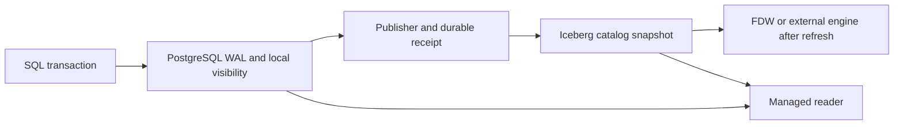

# Anvai Lake DML, visibility, and customer journeys

**Design decision draft.** The product shape is sound if PostgreSQL serves operational changes and Iceberg publishes an explicit, measurable view of those changes. A single SQL interface is good UX. A single freshness promise across two transaction systems would make timeouts, conflicts, and stale reads hard for customers to reason about.

**North star.** An application inserts, updates, and deletes using familiar SQL. It can read its own changes in PostgreSQL, observe when each committed change reaches an Iceberg snapshot, and hand that snapshot to Spark, an FDW query, or another qualified consumer. Every reader sees a complete, explainable version. An operator can tell whether a change is locally durable, waiting to publish, published, or needs reconciliation. Fast local mutation, fast publication, and immediate consumer refresh are separate measurable properties.

Start with external reads and staged append. Qualify direct copy-on-write (COW) for bounded corrections. Keep frequent point changes on ordinary PostgreSQL heap tables with a transactionally recorded outbox or CDC path until the managed current-state model meets the same workload. Support deferred UPDATE and DELETE only after proving row identity, conflict handling, and recovery. This sequences the product by customer value and allows an integrated UX without making an Iceberg scan the hot path of an operational application. [Product and publication proposal](17-anvai-lake-product.md)

## 1. Current state and release boundaries

At #65, opt-in enrollment binds ordinary staged INSERT to its authority and table. A scoped fixture exercises claim, send and lookup across a local restart. The managed reader still needs a compatible published base and visible staged rows. The COW guard rejects delete-bearing source snapshots and moved source pins. The historical defect analysis below motivates the guard. The current release decisions and precise client outcomes are in the [receipt contract](modules/03a-client-receipts.md) and [core release gates](modules/08a-core-release-gates.md).

| Capability | Current implementation | Release posture |
|---|---|---|
| External FDW | Read-only scan of a published Iceberg snapshot. | Qualify snapshot, schema, and delete profiles. A second FDW registration gives a published-view check, with no local overlay. |
| Managed staged INSERT | Captures into a WAL-backed PostgreSQL heap ledger. The configured staged scan path bypasses the remote session and reads locally unpublished segments. | Prototype. It cannot yet promise that one managed relation displays both pre-existing Spark data and locally staged inserts. Once a segment is marked published, a delta-only scan has no remote path to return it. |
| Managed direct COW | In-memory tombstones identify physical file/row positions. UPDATE adds a replacement row. PRE-COMMIT builds an overwrite snapshot. Rows inserted in the same transaction lack an addressable mutation identity. | Restrict to a qualified single-table, delete-safe profile. File path liveness alone cannot prove correctness when another writer adds deletes to a still-live file. |
| Publisher | An opt-in fixture retains the operation identity and send intent in WAL and reconciles an ambiguous response. The legacy worker handles unbound work. | Integrate scoped native dispatch and compatible managed reads, then qualify promoted-primary recovery. |
| Merge-on-read (MoR) | Iceberg read-side support includes position/equality delete cases and v3 DV fixtures. | A supported reader/format matrix is required. Writing DVs or reconstructing PostgreSQL MVCC from them remains separate work. |

The COW rewrite opens a physical file via `pg_datalake_rows_open_path`, which uses `ParquetRows::open` without a snapshot delete set. It filters the transaction's tombstones from that stream. A file with an already deleted row can therefore have that row copied into a replacement file. The existing old-file delete might no longer apply. This risk also exists when another writer introduces a new applicable delete while the target path remains live. Gate COW on a proven delete-free supported input and revalidate it on every attempt until rewrite reads include all applicable snapshot deletes and concurrent delete changes are handled. A delete-bearing table should fail closed when the required proof is unavailable. [TableAM scan and rewrite](../../src/backend/access/lakehouse/tableam.c) · [File-opening ABI](../../src/backend/access/lakehouse/core/pgdatalake-core/src/ffi.rs) · [Commit retry](../../src/backend/access/lakehouse/core/pgdatalake-core/src/session.rs)

## 2. Mental model

Three distinct boundaries matter.

1. **Command visibility.** A subsequent command in the writing transaction sees its own earlier changes under PostgreSQL command rules. Rollback to a savepoint restores the prior state, including update tombstones. Another PostgreSQL session cannot see an uncommitted staged row.
2. **Local commit.** A successful staged transaction has committed heap/WAL records under the configured durability policy. It may acknowledge without contacting the catalog. A locally visible delete can therefore hide a row from the managed reader while Spark and the FDW still see it in the last published snapshot. In the proposed staged mutation mode, a completed local delete is a durable pending operation until external publication is confirmed.
3. **Publication and consumer refresh.** An Iceberg snapshot becomes visible when its intended catalog ref advances. A fresh consumer reaching that ref sees the complete commit. A running or pinned reader can continue to see an older snapshot. Catalog success and consumer visibility have separate timestamps.

“Delta ledger” means ordinary PostgreSQL rows. It uses PostgreSQL MVCC and has no Delta Lake transaction log. Iceberg snapshots describe immutable data/delete files and their applicability. They carry neither PostgreSQL XIDs nor locks across Spark and PostgreSQL. The two histories can be paired only through a durable publication mapping. [PostgreSQL transaction isolation](https://www.postgresql.org/docs/current/transaction-iso.html) · [Iceberg snapshots](https://iceberg.apache.org/spec/#snapshots)

## 3. How deletes and updates reach Iceberg

| Encoding | Meaning and scope | Customer tradeoff |
|---|---|---|
| **Local tombstone** | An operation to hide one observed row version in the managed PostgreSQL view. Staged mutation would store it in WAL with a replacement row for UPDATE. | Fast acknowledgment and local reads. External readers see the previous published version until the mutation is published. |
| **Iceberg COW** | Rewrite touched immutable files with only surviving rows. Publish the replacement files, removed-file metadata and update after-images in one Iceberg snapshot. Preserve historical files while referenced. | Broad read compatibility and lower read amplification. A one-row change can rewrite a large file, and unrelated changes touching that file can conflict. |
| **Iceberg position deletes / v3 deletion vectors (DVs)** | Mask physical row ordinals of a specific data file. Iceberg applies sequence and partition scope. DV writes require v3 writer conformance and must preserve earlier applicable position deletions. Publish the delete representation and any replacement data together. | Less write I/O for sparse changes. Readers need format support and pay delete-application cost. Compaction must apply the correct mask and preserve supported lineage. |
| **Iceberg equality deletes** | Match specified Iceberg field IDs and values over applicable older data sequences and partition scope. An unpartitioned equality-delete spec can apply globally. | Useful when reading externally produced tables. An unconstrained key delete can affect multiple matches. Treat authoring as an interoperability feature to qualify separately. |

A file path and row ordinal identify an immutable physical row only for a specific plan and file generation. A task index or synthetic PostgreSQL TID cannot survive compaction as a logical key. DVs may be cheap to append, but the mutation cannot blindly rebase onto a new file or rely on the original still being live. Iceberg v3 lineage can help locate row versions when all writers maintain it and affected rows have lineage. That feature supplies neither key uniqueness nor distributed row locking. Older files can lack lineage. [Iceberg scan planning](https://iceberg.apache.org/spec/#scan-planning) · [Iceberg row lineage](https://iceberg.apache.org/spec/#row-lineage)

**Delete here means absent from the selected current snapshot.** Historical snapshots, tags, exported copies, PostgreSQL WAL and backups can still retain the row. A purge workflow requires its own retention policy, snapshot-expiry and object cleanup checks, and a completion receipt. A consumer pinned to an old version remains a valid historical reader until that version is retired according to policy.

## 4. Customer journeys and thought experiments

| Journey | Expected experience | Advantage and cost |
|---|---|---|
| **Read a Spark table from PostgreSQL.** An analyst attaches an existing table, queries it, then pins the same snapshot in both systems. | Both return the same row values after applying schema projection and deletes. After Spark publishes a new snapshot, a new supported current read can see it. Pinned reads stay stable. | Easy pilot with existing catalog and credentials. Freshness depends on the consumer's refresh policy. |
| **Ingest an event and run ELT.** An app inserts and commits. A downstream job waits for a specific publication receipt. | The app can see the committed row locally. Before publication the FDW reads the old published version. After verified publication the job can read the receipt's snapshot or refresh current metadata. A timeout returns a retryable wait outcome tied to the same receipt. | Predictable local latency, volume coalescing and an explicit downstream trigger. Operational monitoring must cover backlog and consumer refresh. |
| **Correct a published value.** Starting at `S0` with `id=7, status='open'`, change status to `closed`. | A successful direct COW commit produces `S1` with exactly one row at the new value. The old value stays readable at `S0`. A future staged lane may return `closed` locally while external readers still see `open` at `S0`. A staged UPDATE must publish the deletion and replacement together. | Direct COW gives immediate catalog publication on success, with file rewrites on the hot path. Staging improves app latency and shifts conflict recovery to the publisher. |
| **Delete a pending insert.** INSERT then DELETE in one SQL transaction, or delete a committed local insert before publish. | Same-transaction cancellation removes the insert from publication. For a previously committed insert, preserve local MVCC history. Coalesce the changes only when both are in the same safe publication cut and neither already has a published version. A savepoint rollback restores the matching versions. | Avoids publishing transient state. Requires a durable local row identity and ordered operations. Until supported, reject this managed mutation explicitly. |
| **Spark compacts a file while PostgreSQL updates it.** The observed file path and ordinal change. | Direct COW validates the observed version and either proves a safe retry or fails with a conflict and asks the application to retry the transaction. Deferred DML requires a single writer authority or a qualified version-aware reconciliation policy. | Prevents mutating the wrong row. Conflicting external writers constrain the initial managed offering. |
| **Another engine deletes a neighboring row without rewriting the file.** PostgreSQL rewrites the same file to delete a different row. | The new snapshot contains neither row. The rewrite consumes the applicable delete set from its pinned input and detects any changed covering deletes before commit. A stale rewrite aborts when it cannot prove equivalence. | Prevents resurrection even when the data path is still live. Commit validation includes delete state as well as data files. |
| **The catalog commits but the reply is lost.** The worker restarts before its ledger update. | There is one remote operation. Recovery finds it by durable operation ID, records the verified snapshot, and avoids publishing the rows again. Managed and external readers each return exact results for their advertised snapshot. | Durable outbox semantics let the application continue. Unknown outcomes may require operator reconciliation when recognition is impossible. |
| **A multi-table app transaction commits locally.** Iceberg publishes events before their dimensions. | PostgreSQL can read its local transaction atomically. External consumers receive a per-table publication status and can wait for an explicit exported set of snapshot IDs. | Coordinated handoff offers consistency for batch consumers. Arbitrary external “latest” queries can see different table cuts. Multi-table catalog atomicity needs its own certified feature. |

## 5. Read rules, MVCC and conflict handling

### One view per supported read mode

- **Published view.** Resolve UUID, ref and snapshot at execution or honor an explicit snapshot. Serve Iceberg files and deletes only. Native time travel and the stock snapshot option should resolve to this view. Named refs may move. An execution already pinned to a snapshot stays pinned across scans, parallel workers and rescans.
- **Managed current view.** Pair one PostgreSQL snapshot with a compatible published Iceberg base. Read the base with applicable deletes, apply PG-visible pending mutations absent from that base, then apply changes visible to the current command. Use exact operation membership, not a blanket `published` boolean, a timestamp, or a high-water segment ID. Sequences can be allocated out of commit order. A watermark is usable only if its publication prefix and no-holes invariant are proven.
- **Compatible cut.** If that Iceberg base contains a managed operation newer than the PostgreSQL snapshot, use a compatible retained base and reconcile its overlay. If the engine cannot prove such a cut, decline or raise a documented consistency error. Do not combine independent “latest” fetches. A remote snapshot can include external writes outside PostgreSQL MVCC. Define their visibility at the chosen remote pin.

| Remote base contains operation? | Local ledger status | Managed read rule for a PG-visible committed operation |
|---|---|---|
| No | Pending | Apply local overlay once. |
| No | Published in a newer snapshot | Apply the retained overlay once for this older base. |
| Yes | Pending after lost response | Use published effect and suppress the duplicate overlay. |
| Yes | Published | Use published effect and suppress the duplicate overlay. |

An expired or rolled-back ref can make ancestry alone insufficient. Retain operation membership and ledger history for supported pins, or fail explicitly when proof is unavailable. An older explicit Iceberg snapshot remains a published-only historical view. No PostgreSQL overlay or COUNT shortcut may change it. Tie ledger pruning to retained read cuts, snapshot retention, and recovery state.

### Supported isolation and retry policy

- **Read Committed.** Qualify a fresh compatible cut per statement and the same paired cut for repeated accesses within that statement. Verify command IDs, nested savepoints, RLS, and read-your-writes for each supported operation.
- **Repeatable Read.** Require a transaction-scoped remote pin paired with the PostgreSQL snapshot. Retain files and ledger membership for the pin. Certify this before offering RR on mixed local/remote reads. Until then declare the unsupported combinations explicitly.
- **Serializable and locking.** PostgreSQL SSI cannot see dependencies created by independent Spark writers. A stronger lane requires coordinated authority and a separately proven contract. Row locking, uniqueness, `ON CONFLICT`, foreign keys, arbitrary MERGE and two-phase commit each get separate support status. Ordinary Postgres heap remains the path for application state needing those guarantees.
- **Optimistic direct writes.** Bind to the original UUID/ref, expected schema/spec and observed row/file version. Guard against competing file rewrites, changed applicable delete sets, and matching phantoms when predicate-level semantics are advertised. Start with observed-row semantics and reject operations implying a stronger guarantee until validated. Rebase compatible appends. For a changed or ambiguously retargeted mutation, return a conflict before successful acknowledgment. Never replay a bulk predicate against newly arrived rows as an invisible retry.
- **Durable deferred writes.** Local SQL success cannot later turn into a synchronous transaction abort. Stage UPDATE and DELETE only for supported, versioned targets under a catalog-enforced writer policy or equivalent coordination. A PostgreSQL advisory lock alone cannot fence Spark. Retain unresolved changes, expose their state, and define operator reconciliation without silently discarding acknowledged data. Support stable row identity and expected predecessor versions. A replacement row, delete intent, and outbox record must be committed atomically inside PostgreSQL.

For highly mutable state the preferred early journey is ordinary heap DML plus an outbox committed in the same transaction. Publish an append-only change stream first. A downstream current-state table then needs a qualified apply process for updates and deletes. The same product can provide a managed current-state TableAM later when its correctness and latency surpass that baseline for a measured workload.

## 6. UX and operating contract

Keep the distinction visible through DDL, inspection and client outcomes.

- Offer a table-level choice of **direct publication** or **staged append** with documented operation support. An explicit mode change drains or reconciles outstanding work and checks the bound UUID/ref, schema and version before reopening writes. A session setting must not silently alter a table's consistency contract.
- Give applications a durable receipt for a committed publication unit. Expose its state, oldest pending age, and resulting snapshot or error. A blocking wait uses a bounded timeout and can resume by receipt. Distinguish no change, queued, published, conflict and unknown outcome. An opt-in API can return or look up receipts without redefining PostgreSQL's generic COMMIT response.
- Show the selected Iceberg snapshot and local overlay presence in diagnostics. Apply the same visibility rules to aggregates, indexes, scans, and EXPLAIN. Do not optimize a count with pending deletes, update pairs, or ambiguous publication membership unless it can prove the exact result.
- Document a degraded behavior. The locally durable write contract can survive a catalog outage within bounded disk and WAL limits. A table with an existing remote base requires access to a proven compatible cached base to serve a complete managed read offline. Otherwise report which dependency is unavailable. Warn before queue saturation and apply configured backpressure.
- Publish per-profile limits. Report staging acknowledgment, oldest pending age, catalog lag, consumer lag, mutation conflict/retry rates, write amplification, read amplification, and small-file debt. Use the size/age scheduling targets in [the publication spec](17-anvai-lake-product.md#4-publication-by-size-or-age). Latency applies to a documented load and availability profile.

## 7. Milestones and gates

| Gate | Ship when | Red tests and measured smoke |
|---|---|---|
| **M1 read qualification** | Published FDW and qualified managed published view agree, with clear profile and delete support. | Spark writes append and delete snapshots. Verify equal row digests and time travel on PostgreSQL and a second engine. Measure attach time, first-row time, bytes and delete cost. |
| **M2 append and COW qualification** | Local staged INSERT serves a complete paired current view. Direct COW handles a declared safe input profile, with unsupported mutations rejected. | Reproduce staged scan omission after publication, old-base/new-ledger and new-base/old-ledger races, two appends, direct update/delete, and neighboring-delete resurrection. Verify exact pinned rows and no visible partial update. Measure local acknowledgment and file rewrite volume. |
| **M3 publication and MVCC** | Durable publication claims, prepared-plan freshness, recovery, explicit pin lifetimes, and size/age scheduler work together. Qualify direct write and staged append by catalog. | Fault before and after catalog CAS, then restart. Exercise same-count delete changes, nested rollback and two-session reads under each claimed isolation level. Run 20s and 60s profiles at sparse, steady, burst and recovery load. Measure p50/p95 lag where sampled, pending age, WAL, and conflict rate. |
| **M4 selective mutations** | Proven demand and resource budgets justify narrow deferred UPDATE/DELETE or DV writing. Contend with only coordinated writers initially. Keep fast fallback to heap/outbox. | Exercise key changes, delete before publish, repeated update, compaction during pending mutation, same-key conflict, retired snapshots and v3 lineage across independent readers. Compare COW and MoR for the same logical workload. Measure GETs, files and bytes rewritten, delete amplification and application p95. |
| **M5 wider write interoperability** | Qualify additional catalog profiles, and only advertise multi-writer or multi-table behavior covered by the contract. | Test independent writers, migration, credential rotation, conflict/recovery, and coordinated snapshot-set handoff with each advertised engine. Require exact rows and lag receipts for supported profiles. |

For each gate, write the failure test first and check SQL-level exact rows against an independent oracle. Use deterministic catalog barriers for races and replay. After each milestone, smoke a clean install and upgrade, then retain candidate SHA, engine and catalog versions, input snapshots, expected result hashes, logs and raw measurement distributions. Include a fail-closed control for every unsupported profile. [TDD and smoke receipt protocol](10-testing.md#milestone-tdd-and-smoke-receipts)
