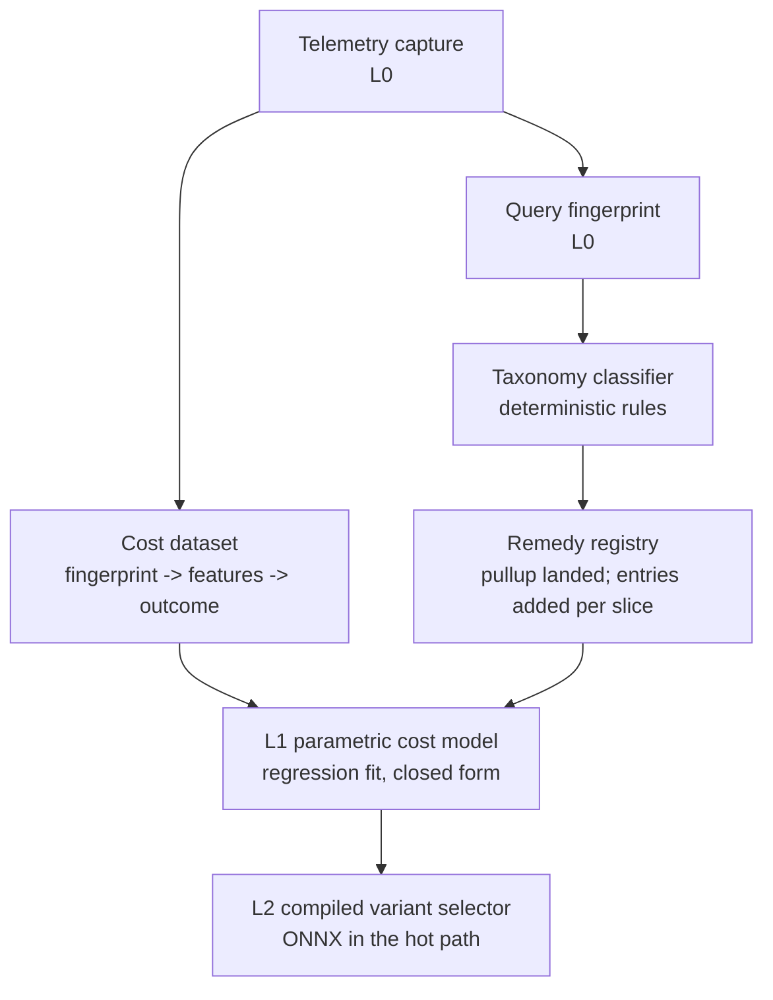

# Query-shape taxonomy, telemetry, and the cost-model ladder

**Design decision draft.** Per-query tuning does not scale to the full benchmark surface. Qualification work on TPC-H and TPC-DS produced distinct pathology classes with different remedies, and the q1 fix proved one class closes with a single equivalence-proven rewrite. This spec fixes the taxonomy, the telemetry contract that makes classes self-identifying, and a staged cost model that ends with compiled (ONNX) decision models in the planner hot path.

**North star.** Every slow query classifies into one shape family whose remedy is a deterministic, equivalence-proven rewrite or transport change. A telemetry-backed cost layer chooses among proven-equivalent variants per query. Model decisions are microseconds, inspectable, and fail safe: a wrong model choice costs performance, never correctness.

## 1. Where this stands

At the pullup slice ([PROGRESS](PROGRESS.md) "Cost and expansion" track + the spec-19 row, landed in #104): q1 closed by the planner-hook rewrite (category A below); the matcher declines fail-safe everywhere else. q4/q6 timeouts are not category A and remain undiagnosed. Scans are M1 (projection pushdown only); row transport is tuple-per-row; receipts come from `scripts/perf/lakehouse_perf.py` (medians only, no per-phase resource attribution).

## 2. The taxonomy

| # | Shape family | Known members | Bottleneck signature (telemetry) | Remedy lever |
|---|---|---|---|---|
| A | Correlated-agg SubPlan over a foreign-table CTE | q1 (fixed) | subplan evaluations ≈ outer rows × ctr rows; per-eval time ≈ CTE scan slice | planner pullup (landed): grouped subquery + INNER join, O(N+M) |
| B | Correlated EXPR SubPlans the pullup declines (volatile, OR-embedded, multi-level correlation, havingQual) | q4, q6 (suspected, unconfirmed) | same rescan signature on declined shapes | executor-side hashed/memoized EXPR SubPlans keyed on the correlation params — **volatile-bearing shapes stay declined with no remedy (memoization is semantics-changing there)**; non-volatile correlated EXPR subplans re-execute per row (uncorrelated ones already run once via InitPlan) |
| C | Row-transport-bound | q2, q7; TPC-H q2/q7 canaries | remote scan fast, executor + client slow; high row count ÷ scan time | typed batch/chunk transport or deeper pushdown |
| D | Overfetch | q9 (128 s), q5 | files examined = total files regardless of quals; no range-GET reduction | snapshot-stats pruning (per-file min/max), predicate pushdown past M1 |
| E | Cardinality misestimate on foreign tables | latent everywhere | planner estimated rows vs actual rows divergence; bad join order in EXPLAIN | stats ingestion (composed per-file value_counts + sampling — Iceberg has no global NDV; see §4b), ANALYZE-grade |

Assignment rule: a query enters exactly one family by its dominant telemetry signature; composites (A+D) are recorded as primary+secondary and each remedy applies independently.

## 3. Dependency order (foundational layers first)

Hard ordering rules:

1. **Telemetry before taxonomy**: no family is confirmed until its signature is measured on the full sweep; q4/q6 remain "suspected B" until instrumented.
2. **Registry before model**: an ONNX model may only rank remedy registry entries whose equivalence is statically proven (pullup shape-proven; hashed subplan to be proven in its slice). A category with no proven remedy contributes no model features.
3. **Data before fit**: L1 fits only after the full labeled sweep (TPC-DS 99 + TPC-H 21) populates the dataset; L2 trains only if L1's residuals justify it (threshold: L1's wrong-variant rate ≥ 10% on the labeled sweep — the same quantity §7's L1 exit accepts below 10%).
4. **Compiled model last**: ONNX enters the hot path only after L1 proves the decision is (a) needed per-statement and (b) expressible as the small feature vector in §6.3.

## 4. Telemetry contract (L0)

New GUC-gated capture — `lakehouse.telemetry` (bool, default on) gates capture;
`lakehouse.telemetry_retention` bounds the heap table:

- **Fingerprint**: `shape_hash` = a canonical walk of the parse tree emitting
  node-class tags only (sublink type, join kind, aggregate oid, operator oids —
  literal/constant values and rtable oids excluded), hashed with a version
  salt so walk changes invalidate old fingerprints explicitly;
  `param_signature` = the sorted list of bound-param value classes
  (numeric/string/bool/null), never raw values. Same fingerprint = same plan
  shape family = comparable runs.
- **Planner side**: plan time, rewrite entries applied/declined (line-level,
  from the existing DEBUG1 decl sites), chosen variant, **planner estimated
  row count per foreign scan** (family E's signature needs it — the pass
  records the estimate before rewrite and the post-rewrite shape after).
- **Scan side**: per foreign scan — **elapsed**, files examined, scan tasks,
  metadata rows, rows returned, catalog/S3 request counts and bytes (new
  capture plumbing through the Rust core + FDW exec state; today's EXPLAIN
  carries only files examined/pruned, tasks, rows, projection — the by-kind
  GET/byte/latency/tier counters of §4b do not exist yet).
- **Executor side**: per SubPlan — evaluation count, per-eval elapsed, rescan
  tuple count (the A/B signature), hashed-subplan hit/miss once B exists.
- **Resource**: backend CPU (getrusage), palloc high-water, tuplestore bytes
  spilled.
- **Phase attribution**: executor total is split into scan time (sum of
  foreign-scan elapsed), subplan time (sum of subplan elapsed), and other
  (difference) — family assignment ranks families by **largest attributed
  time share**; a family is "dominant" only above 50% of attributed time,
  otherwise the query is composite (primary + secondary).
- **QPS framing**: driver computes QPS = 1/median per fingerprint across
  builds; the regression signal for every slice.

`lakehouse_perf.py` gains `--telemetry`: one JSON line per query run (fingerprint, timings, counters, resources) appended to a dataset file. No new infrastructure; receipts discipline unchanged.

### 4a. Persistence and consent (L0.5)

Telemetry persists in **extension-internal, tenant-owned** tables — same posture as the staged-delta store (created by the extension script, `REVOKE ALL FROM PUBLIC`, no catalog visibility without explicit grant):

- **Latest records stay in heap**: `lakehouse.query_stats` is an internal
  TABLE (not a view — RULES §4 reserves `pg_lakehouse` for views; the
  capture-side naming is extension-internal), fields captured_at, dbid,
  userid, queryid, rows, total_ms, foreign_scans, retention-bounded by
  `lakehouse.telemetry_retention` (default 100k rows). Capture runs as the
  table owner (RI-trigger user-context switch) so unprivileged invokers are
  captured without grants. Child streams land with the physical collector
  (§4c item 3): `lakehouse.query_stats_scans` (one row per foreign scan,
  FK by query row) and `lakehouse.query_stats_subplans` (one row per
  SubPlan) — per-scan and per-SubPlan counters never collapse into the
  parent row.
- **Flush = swallow-all**: the flush runs in the commit callback and must
  catch every failure (drop the batch, bump a dropped-batch counter, never
  ereport upward) — an unhandled error there cannot roll committed work
  back, but it tears down the session.
- **Aged records go to object store — TWO-PHASE, matching the publisher's
  real constraint** (it cannot emit segments staged in its own uncommitted
  transaction; verified in the capture slice): `flush_query_stats()` call N
  drains the heap into the tenant's managed Iceberg archive table
  (`USING lakehouse` + `attach_table`) and reports state 'staged' with a
  NULL snapshot; call N+1 (a later transaction) publishes via
  `publish_table` and reports state 'published' with the verified snapshot
  id. Tenant-specific by construction (their catalog, their warehouse).
- **Operator sharing is consent-gated, never implicit**: the consent ledger
  holds ONE row = one consent decision covering one endpoint
  (granted/endpoint/granted_by/granted_at/shared_at);
  `revoke_operator_telemetry()` closes it.
  `share_query_stats_with_operator()` fails closed (55000) until an admin
  calls `grant_operator_telemetry(endpoint)`.
  **Shareable projection (fixed now, not deferred)**: operator sharing
  releases per-fingerprint AGGREGATES only — fingerprint, call count,
  total/median time, scan counters — never raw rows, never userid, never
  `param_signature` (on a low-cardinality domain the param class IS the
  value), never column min/max values. Cross-tenant query-pattern
  correlation via shape fingerprints is inherent to fleet training and is
  part of what the consent covers; it is stated in the consent contract.
  Raw-row sharing requires a future consent-tier schema change, not this
  ledger. `table_stats`/`column_stats` (§4b) carry the same internal
  REVOKE-ALL posture and the same aggregate-only shareable rule.

### 4b. Physical and storage statistics catalogue (L0 collector)

Feeds families D (overfetch/pruning) and E (cardinality) and the cost model's currency. All collected from structures the core already parses (Iceberg manifests, Parquet footers) — **zero additional origin requests beyond the scan itself**.

Per-snapshot table stats (`lakehouse.table_stats`):

| Field | Feeds |
|---|---|
| row_count, data-file count, delete-file count/bytes, file size min/avg/total | E cardinality; D pruning benefit |
| **manifest-list + per-manifest bytes/counts** | the lists-vs-gets tradeoff: planning GETs scale with manifest count — visible before any manifest-cache slice |
| partition fields + transforms vs regular columns | pruning tier 0 (manifest-level) |
| column count, avg row width (Parquet footer), total bytes | wide/narrow → projection pushdown + batch-transport value (family C) |

Per-column stats (`lakehouse.column_stats`): null count, min/max presence,
datatype class, and the derived **filterability tier**. Iceberg carries NO
global NDV — the tier derives from per-file `value_counts` composed by sum
(AN EXPLICIT OVERESTIMATE when values repeat across files; Parquet footer
`distinct_count` used where present and the composed value recorded as
upper-bound), with fixed thresholds and precedence:

- **T0 partition column** (manifest-level prune) — first match wins.
- **T4 unfilterable**: nested type, or no metrics (all bounds absent).
- **T3 boolean/temporal**: boolean columns; date/timestamp columns with
  min/max present (range prune with high selectivity per unit range).
- **T2 enum-like**: composed-NDV ≤ 100 AND composed-NDV/row_count ≤ 0.05
  (dictionary/value-set prune).
- **T1 high-selectivity**: composed-NDV > 100 and min/max present
  (row-group prune).
- else **T4**.

Precedence is strictly top-down; a boolean column is T3, never T2. Raw
min/max values stay tenant-local (§4a); only the tier and aggregates are
shareable. Family E's remedy uses the same composed cardinalities plus
sampling, never a nonexistent Iceberg NDV field.

Storage-op telemetry per scan (extends the #66 canary counters, recorded into query_stats): ListObjects count, GetObject count **by kind** (manifest-list, manifest, footer, data-range, DV), bytes per kind, latency p50/p90, **object storage tier** (from storage-class headers), and avoided-bytes/GETs vs the unpruned baseline. A per-deployment pricing table (GUC) turns counters into a cost-per-query currency alongside time — a Glacier range-GET prices retrieval fees and latency differently from Standard, which the L1 model must respect.

### 4c. Slice interdependencies (binding order)

1. `feat/spec-19-cbo-taxonomy` (this spec) — the contract.
2. **Query-stats capture** (L0, branch `feat/telemetry-stats`): internal table + hooks + retention + flush/share/consent. Depends on: this spec. Blocks: everything below.
3. **Physical stats collector** (L0): `table_stats`/`column_stats` tables + snapshot-scoped collection at first scan per snapshot. Depends on: 2 (persistence + consent machinery). Blocks: D-remedy (pruning), E-remedy (stats).
4. **Full-sweep qualification with telemetry** — populates the taxonomy empirically (q4/q6 confirm/refute family B). Labeled sweep scope: ALL TPC-DS 99 + TPC-H 21 queries. Depends on: 2 (+3 for D/E labels). Blocks: 5.
5. **Registry entry 2 — hashed EXPR SubPlans** (the family-B remedy): equivalence table (NULL-parity per operator), matcher, fixtures, q4/q6 receipts. Depends on: 4 confirming family B's scope. Blocks: 6 (the L1 variant choice needs both variants to exist).
6. **L1 parametric model** — depends on: 4's dataset + 5's second variant. Blocks: 7.
7. **L2 ONNX selector** — depends on: 6's residuals justifying it (§3 rule 3).

## 5. Remedy registry (L1)

Each entry: matcher (deterministic, fail-safe declines), rewrite (equivalence proof obligation), telemetry signature it targets, decline behavior (SubPlan kept). **Registry entry template obligations: an equivalence proof AND a volatile-decline clause** — any memoization- or rewrite-bearing remedy must decline shapes containing volatile functions (a cached or moved volatile evaluation changes observable behavior). Entry 1 is the landed pullup (volatile decline already enforced); entry 2 (hashed EXPR SubPlans — note the family-B population is *correlated* EXPR SubPlans; uncorrelated ones already run once via InitPlan) carries the next proof obligations: the NULL-parity table per operator AND volatile-declined memoization. Transport (C) and pruning (D) land as their own slices; E is a stats slice. The registry is the only place ML may later influence: **the model ranks entries; it never bypasses the matcher.**

## 6. The cost-model ladder

### 6.1 L0 — deterministic rules (now)
Matcher categories decide; no model. Every current behavior stays in this lane until §3 rule 3 is satisfied.

### 6.2 L1 — parametric cost model
Closed-form cost functions per variant, coefficients fitted by regression on the telemetry dataset: e.g. `cost_pullup ≈ a·M_group + b·N_probe + c·scan`, `cost_subplan ≈ N·(d·M + e)`; choose the cheaper. Inspectable, printable in EXPLAIN, and the reference implementation for L2.

### 6.3 L2 — ONNX-compiled variant selector in the hot path
The decision runs in `lakehouse_count_exec_planner` between matcher pass and standard_planner — ONCE per statement at plan time, never per row. **Hot-path contract (binding for every layer built on this spec)**: capture is lock-free in-memory only (no locks, no I/O, no table access at capture time); the flush runs off the execution path at commit (a background-drain lane via the publisher-worker pattern is the v2 upgrade that removes even that); the ONLY hot-path logic is the compiled-model decision, and its throughput is a measured, budgeted property — cheap enough to be non-prohibitive, structured enough to stay learnable.

**Capacity ladder** — model capacity is a measured dial, not a guess. Each level ships only with (a) a measured p99 decision latency via the embedded evaluator on EVERY active profile per §6.4 rule 3 and (b) an accuracy receipt (wrong-variant rate on the labeled sweep vs L1). Bigger weights must BUY accuracy: a level with no wrong-variant improvement over the incumbent is rejected regardless of latency.

| Level | Features k | Ensemble | Relative weights (trees × depth, summed over ensemble members; anchored to the B0 TREE variant) | p99 budget | Ships when |
|---|---|---|---|---|---|
| B0 | 16 | linear classifier or 1 shallow tree | 1× | ≤ 25 µs | L1 residuals justify L2 |
| B1 | 32 (2×) | GBT, 2× depth, 2× trees | ~4× | ≤ 50 µs | beats B0 on the sweep |
| B2 | 32 | GBT, 4× depth, 4× trees, 3-model ensemble | ~16× | ≤ 100 µs | beats B1 materially (≥ 1/3 of remaining wrong-variants) |
| B3 | 64 (per-statement histograms of historical fingerprint timings) | largest ensemble the evaluator holds | ~64× | ≤ 250 µs | opt-in `lakehouse.decision_profile = xl` for measurement, never default |

- **Model classes**: tree ensembles / linear classifiers only — the preferred runtime is the embedded evaluator for the restricted ONNX subset (TreeEnsemble/LinearClassifier ops); a full `ort` C API build with a statically linked onnxruntime core is the fallback ONLY if a future model needs ops outside the subset. **All features pre-planning-available at the hook's insertion point** (the raw parse tree, before any planning): parse-tree-derived properties (sublink/aggregate/operator classes from the matcher's shape walk), §4b table_stats cardinalities, filterability-tier histograms, param-class counts, manifest/file counts, **historical per-fingerprint storage-op counter aggregates from query_stats/query_stats_scans (§4a) — with a zero-history sentinel for first-sighting fingerprints — historical fingerprint timings from query_stats**. Planner row estimates do NOT exist at this point and are not features (family E's complaint about weak pre-planning cardinality is acknowledged — the model compensates with table_stats + selectivity defaults). Matcher DECLINE paths are never features; the doctrine "the model never enables a declined rewrite" is unaffected.
- **Capacity receipts are re-run on every model swap**: a content-hashed artifact ships with its ladder row (level, measured p99, sweep accuracy); the telemetry dataset records which hash decided each run. A new model must beat the incumbent on the pinned sweep at its level's budget before rollout — capacity never ships on faith.
- **Hot-path discipline**: model bytes AND the feature sources are cached per backend — the model artifact plus a lazily-loaded feature snapshot (§4b stats + historical aggregates, read once at the first decision, refreshed off-path via the same background-drain lane as §4a) — so the decision itself reads only memory (heap reads at plan time cannot meet B0's budget); inference is one `Run` call or a tree-walk over a pre-flattened array; allocation-free after warmup; a model load failure or version mismatch falls back to L1 permanently for that backend (one WARNING, no per-query cost). **Runtime output faults are inputs to the same fallback**: a non-finite (NaN/Inf) score, a class index outside the registry-entry range, or an argmax tie (broken deterministically by lowest index) sends THAT statement to L1 and increments a telemetry counter — a TreeEnsemble fed an unexpected input can emit exactly this garbage. Each ladder level's p99 budget is a hard ceiling measured in §7; a level that misses its ceiling ships at the next lower level. **The default-path ceiling is B2's ≤100 µs p99** (B0's 25 µs and B1's 50 µs are the earlier rungs; B3 is opt-in xl and never default) — this supersedes the single-model 50 µs figure of earlier revisions.
- **Versioning**: the model artifact carries a content hash; the telemetry dataset records which hash decided each run, closing the retraining loop. Model swaps are data-only changes (no recompile), gated by the same receipt discipline: a new model must beat the incumbent on the pinned sweep before rollout.
- **Fail-safe doctrine**: L2 may only select among registry entries the matcher has already proven equivalent for the statement at hand. Decline paths, volatile guards, and the foreign-CTE gate are not model inputs — they remain deterministic code. Semantics never depend on model output.

### 6.4 Measurement matrix (multi-hardware, multi-scale)

Ladder receipts and QPS baselines are only correct when accumulated ACROSS
hardware profiles and scale factors on pinned engine versions and identical
dataset snapshots. A single-box number is an anecdote, not a receipt.

**Host profiles** (extend as hardware joins; profile ids are stable):

| id | host | CPU | RAM | storage | character |
|---|---|---|---|---|---|
| wsl2-dev | WSL2 workstation (current dev box) | laptop-class, few cores | 16-32Gi | NVMe-class | fast-storage, CPU-bound at scale |
| dataserver3 | singh.local server | 32c Xeon E5-2630L v3 @1.8GHz | 30Gi | 4x419G rotational RAID | many-cores, storage-latency-bound — the honest profile for object-store-heavy workloads |

**Scale factors**: TPC-H/TPC-DS SF=1 and SF=10 minimum on every profile; SF=100
on dataserver3 when disk headroom allows (SF1 exists to debug shapes, SF10 to
compare, SF100+ to trust).

**Comparability rules**:

1. Every receipt JSON records the profile id, CPU model, core count, RAM,
   storage class (ROTA flag), kernel, engine commit, build type and the exact
   dataset snapshot ids — the perf driver gains `--profile-id` and refuses to
   write receipts without it.
2. Cross-profile comparison is only valid for the SAME snapshot ids and engine
   commit; the pinned-receipt machinery (RULES §10 + [10-testing](10-testing.md)
   "Milestone TDD and smoke receipts") enforces the dataset/engine pins.
3. Ladder levels (§6.3) must meet their p99 budget on the SLOWEST profile in
   the active matrix — shipping on the fast box alone is not compliance.
   Per-profile budget notes ride in the receipt (a B2 decision at 80µs on
   NVMe and 180µs on dataserver3 is one receipt, not two).
4. The physical collector and the labeled sweep (§4c item 4) run on EVERY
   profile: family signatures (storage-bound vs CPU-bound) are expected to
   differ across profiles, and that difference is itself training data for
   the cost model — the model learns per-profile behavior from per-profile
   telemetry (profile id enters as an ordinal slot in the fixed 1×k tensor —
   trees split on the index; a newly joined profile invalidates the incumbent
   model and forces a retrain/re-receipt; the §6.3 k-budget accommodates the
   slot by replacing a scalar feature slot at B1+).
5. CI (GitHub runners) measures neither ladder latency nor QPS — CI pins
   correctness only. Performance receipts come exclusively from the named
   profiles, cold-cache protocol documented per run.

### 6.5 L1 seam — planner-visible foreign-table cardinality (landed 2026-11-26)

The q4 profile (2026-11-26, both hardware profiles) exposed family E at its
root: every un-ANALYZEd foreign table planned as core's rows=1000 default
(costsize.c set_foreign_size_estimates), so the six-way `year_total` CTE
self-join planned as Nested Loop chains over multi-million-row inputs. The
relsize slice grounds the cost model in Iceberg metadata:

- `lakehouse.plan_rows_mode = metadata` (default): when a foreign table has
  no catalog statistics (reltuples < 0), GetForeignRelSize sums the
  snapshot's parquet record_counts through a metadata-only scan session and
  caches it per backend (key: relid; failed fetches cached so a dead
  endpoint costs one attempt per session). `lakehouse.plan_rows_mode =
  default` retains the core default as escape hatch.
- `lakehouse.plan_rows_scale` (PGC_SUSET, default 1.0): per-profile
  multiplier on metadata rows — the operator-facing L1 calibration knob.
  Tuning loop: run the labeled sweep with `--profile-id`, fold
  lakehouse.query_stats (per-query ms) against table_stats cardinalities via
  scripts/perf/telemetry_report.py, adjust scale in postgresql.conf, repeat.
  The model influences planning inputs ONLY; rewrite admission stays with
  the L0 matcher (§6.1 doctrine unchanged).
- Known residual (family E, next slice): join/column selectivity still uses
  core defaults (DEFAULT_NUM_DISTINCT 200) without pg_statistic — q4's
  outer CTE join stays Nested Loop until the ANALYZE/NDV slice populates
  real per-column NDV from §4b column_stats. Fixture pins the current
  estimate (5000-row table with one qual plans 5000/200 = 25 rows).
- Fail-fast boundary (pre-existing contract, lakehouse.h): EXPLAIN runs
  ExecutorStart(EXPLAIN_ONLY), and BeginForeignScan opens its session
  unconditionally — an unreachable endpoint fails the statement at plan
  time regardless of plan_rows_mode. The relsize fail-safe (decline to
  core default) applies to metadata-fetch failures that occur BEFORE that
  boundary (clamped rows, dead endpoint on a rel reached only through the
  metadata path); the fixture pins both behaviors.

Canonical data law (2026-11-26): ONE Iceberg dataset copy lives in the
dataserver3 Garage bucket `warehouse`; compute servers target it over the
network (WSL2 profile = remote-S3 latency class, ds3 profile = local class).
Garage keys are imported (GK-format IDs, 64-hex secrets) so both stores
accept identical credentials; the compose fixture stack (CI-fast tier)
remains SeaweedFS until the compose-swap slice lands.

## 7. Exit criteria per layer

| Layer | Exit receipt |
|---|---|
| Telemetry | `--telemetry` run over the full labeled sweep produces a complete dataset; per-SubPlan counters reproduce the q1 signature (mechanics note: this needs one throwaway scratch build of the instrumentation against a pre-#104 tree — a RULES-compliant local measurement, never a cherry-pick onto a living branch) |
| Taxonomy | every timed query carries a family label; composite queries recorded; unknown-signature queries explicitly listed |
| Registry | entry 2 (hashed subplan) merged with its equivalence table + fixture, red→green, q4/q6 receipts |
| L1 | fitted coefficients published in the spec; leave-one-query-out validation on the sweep; wrong-variant rate < 10% |
| L2 | ladder receipts published (every level: measured p99 within its budget per §6.4 rules 1 and 3 + wrong-variant rate vs incumbent); model-vs-L1 agreement report; fault-injection fixture covers load failure AND runtime garbage (NaN/Inf, out-of-range class, argmax tie) each falling back to L1; **an equivalence-under-either-choice fixture runs the same statement under the selected and the non-selected proven-equivalent variant and asserts identical rows** (the north-star claim, tested) |

## 8. Non-goals

- ML never gates a rewrite: matcher output is not a feature, and no learned component can enable a rewrite the deterministic gate declined.
- No official TPC certification track; the DuckDB-over-same-S3 envelope run remains the external sanity bound (exploratory, documented).
- No model training inside the server: training is offline tooling; the server only runs exported artifacts.
- No per-query online learning: the loop is batch retrain from telemetry, receipt-gated.
