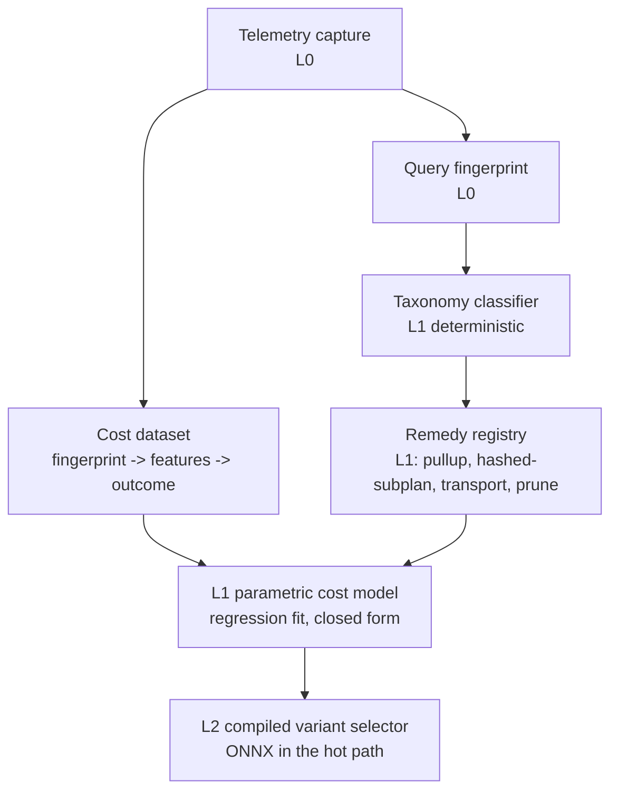

# Query-shape taxonomy, telemetry, and the cost-model ladder

**Design decision draft.** Per-query tuning does not scale to the full benchmark surface. Qualification work on TPC-H and TPC-DS produced distinct pathology classes with different remedies, and the q1 fix proved one class closes with a single equivalence-proven rewrite. This spec fixes the taxonomy, the telemetry contract that makes classes self-identifying, and a staged cost model that ends with compiled (ONNX) decision models in the planner hot path.

**North star.** Every slow query classifies into one shape family whose remedy is a deterministic, equivalence-proven rewrite or transport change. A telemetry-backed cost layer chooses among proven-equivalent variants per query. Model decisions are microseconds, inspectable, and fail safe: a wrong model choice costs performance, never correctness.

## 1. Where this stands

At the pullup slice (spec [03](03-catalog.md), [PROGRESS](PROGRESS.md) "Correlated-agg pullup"): q1 closed by the planner-hook rewrite (category A below); the matcher declines fail-safe everywhere else. q4/q6 timeouts are not category A and remain undiagnosed. Scans are M1 (projection pushdown only); row transport is tuple-per-row; receipts come from `scripts/perf/lakehouse_perf.py` (medians only, no per-phase resource attribution).

## 2. The taxonomy

| # | Shape family | Known members | Bottleneck signature (telemetry) | Remedy lever |
|---|---|---|---|---|
| A | Correlated-agg SubPlan over a foreign-table CTE | q1 (fixed) | subplan evaluations ≈ outer rows × ctr rows; per-eval time ≈ CTE scan slice | planner pullup (landed): grouped subquery + INNER join, O(N+M) |
| B | Correlated EXPR SubPlans the pullup declines (volatile, OR-embedded, multi-level correlation, havingQual) | q4, q6 (suspected, unconfirmed) | same rescan signature on declined shapes | executor-side hashed/memoized EXPR SubPlans keyed on the correlation params (upstream hashes only `IN`; `EXPR` re-executes per row) |
| C | Row-transport-bound | q2, q7; TPC-H q2/q7 canaries | remote scan fast, executor + client slow; high row count ÷ scan time | typed batch/chunk transport or deeper pushdown |
| D | Overfetch | q9 (128 s), q5 | files examined = total files regardless of quals; no range-GET reduction | snapshot-stats pruning (per-file min/max), predicate pushdown past M1 |
| E | Cardinality misestimate on foreign tables | latent everywhere | planner rows vs actual rows divergence; bad join order in EXPLAIN | stats ingestion (Iceberg metadata ndv/counts + sampling), ANALYZE-grade |

Assignment rule: a query enters exactly one family by its dominant telemetry signature; composites (A+D) are recorded as primary+secondary and each remedy applies independently.

## 3. Dependency order (foundational layers first)

Hard ordering rules:

1. **Telemetry before taxonomy**: no family is confirmed until its signature is measured on the full sweep; q4/q6 remain "suspected B" until instrumented.
2. **Registry before model**: an ONNX model may only rank remedy registry entries whose equivalence is statically proven (pullup shape-proven; hashed subplan to be proven in its slice). A category with no proven remedy contributes no model features.
3. **Data before fit**: L1 fits only after the full 99-query sweep populates the dataset; L2 trains only if L1's residuals justify it (documented threshold: L1 relative-error p90 > 2× on the variant-choice decision).
4. **Compiled model last**: ONNX enters the hot path only after L1 proves the decision is (a) needed per-statement and (b) expressible as the small feature vector in §6.3.

## 4. Telemetry contract (L0)

New GUC-gated capture (`lakehouse.query_stats` view; default off, session-settable):

- **Fingerprint**: `shape_hash` (node-class skeleton of the parse tree: sublink shapes, join kinds, aggregate ids — literal/constant values excluded) + `param_signature` (bound param values class). Same fingerprint = same plan shape family = comparable runs.
- **Planner side**: plan time, rewrite entries applied/declined (line-level, from the existing DEBUG1 decl sites), chosen variant.
- **Scan side**: per foreign scan — files examined, scan tasks, metadata rows, rows returned, catalog/S3 request counts and bytes (extends the #66 canary counters already in EXPLAIN).
- **Executor side**: per SubPlan — evaluation count, per-eval elapsed, rescan tuple count (the A/B signature), hashed-subplan hit/miss once B exists.
- **Resource**: backend CPU (getrusage), palloc high-water, tuplestore bytes spilled.
- **QPS framing**: driver computes QPS = 1/median per fingerprint across builds; the regression signal for every slice.

`lakehouse_perf.py` gains `--telemetry`: one JSON line per query run (fingerprint, timings, counters, resources) appended to a dataset file. No new infrastructure; receipts discipline unchanged.

## 5. Remedy registry (L1)

Each entry: matcher (deterministic, fail-safe declines), rewrite (equivalence proof obligation), telemetry signature it targets, decline behavior (SubPlan kept). Entry 1 is the landed pullup; entry 2 (hashed EXPR SubPlans) carries the next proof obligation — NULL-semantics parity table per operator, mirroring the pullup's §"Equivalence cases". Transport (C) and pruning (D) land as their own slices; E is a stats slice. The registry is the only place ML may later influence: **the model ranks entries; it never bypasses the matcher.**

## 6. The cost-model ladder

### 6.1 L0 — deterministic rules (now)
Matcher categories decide; no model. Every current behavior stays in this lane until §3 rule 3 is satisfied.

### 6.2 L1 — parametric cost model
Closed-form cost functions per variant, coefficients fitted by regression on the telemetry dataset: e.g. `cost_pullup ≈ a·M_group + b·N_probe + c·scan`, `cost_subplan ≈ N·(d·M + e)`; choose the cheaper. Inspectable, printable in EXPLAIN, and the reference implementation for L2.

### 6.3 L2 — ONNX-compiled variant selector in the hot path
The decision runs in `lakehouse_count_exec_planner` between matcher pass and standard_planner; budget ≤ 50 µs p99 (planner time is already multi-ms for these queries; the budget is a floor requirement, not headroom).

- **Model**: gradient-boosted trees or small MLP trained offline on the L1 dataset, exported to ONNX, inference via a vendored minimal ONNX runtime (CPU EP, no dynamic shapes, fixed input tensor 1×k where k ≤ 16 features: outer rows est., ctr rows est., param ndv, agg type class, operator class, table cardinalities, historical fingerprint timings). Candidate runtimes, in preference order: (1) `ort` C API with a statically linked onnxruntime core; (2) an embedded evaluator for the restricted ONNX subset (TreeEnsemble classifier/LinearClassifier ops only) — no external dependency at all if the model stays in that subset, which is the expected case.
- **Hot-path discipline**: model bytes + tensors loaded once per backend at first decision (lazy, like the AM oid cache); inference is one `Run` call or a tree-walk over a pre-flattened array; allocation-free after warmup; a model load failure or version mismatch falls back to L1 permanently for that backend (one WARNING, no per-query cost).
- **Versioning**: the model artifact carries a content hash; the telemetry dataset records which hash decided each run, closing the retraining loop. Model swaps are data-only changes (no recompile), gated by the same receipt discipline: a new model must beat the incumbent on the pinned sweep before rollout.
- **Fail-safe doctrine**: L2 may only select among registry entries the matcher has already proven equivalent for the statement at hand. Decline paths, volatile guards, and the foreign-CTE gate are not model inputs — they remain deterministic code. Semantics never depend on model output.

## 7. Exit criteria per layer

| Layer | Exit receipt |
|---|---|
| Telemetry | `--telemetry` run over the full TPC-DS 99-query sweep produces a complete dataset; per-SubPlan counters reproduce the q1 signature on a pre-pullup build |
| Taxonomy | every timed query carries a family label; composite queries recorded; unknown-signature queries explicitly listed |
| Registry | entry 2 (hashed subplan) merged with its equivalence table + fixture, red→green, q4/q6 receipts |
| L1 | fitted coefficients published in the spec; leave-one-query-out validation on the sweep; wrong-variant rate < 10% |
| L2 | decision latency ≤ 50 µs p99 measured; model-vs-L1 agreement report; fallback path exercised by a fault-injection fixture |

## 8. Non-goals

- ML never gates a rewrite: matcher output is not a feature, and no learned component can enable a rewrite the deterministic gate declined.
- No official TPC certification track; the DuckDB-over-same-S3 envelope run remains the external sanity bound (exploratory, documented).
- No model training inside the server: training is offline tooling; the server only runs exported artifacts.
- No per-query online learning: the loop is batch retrain from telemetry, receipt-gated.
