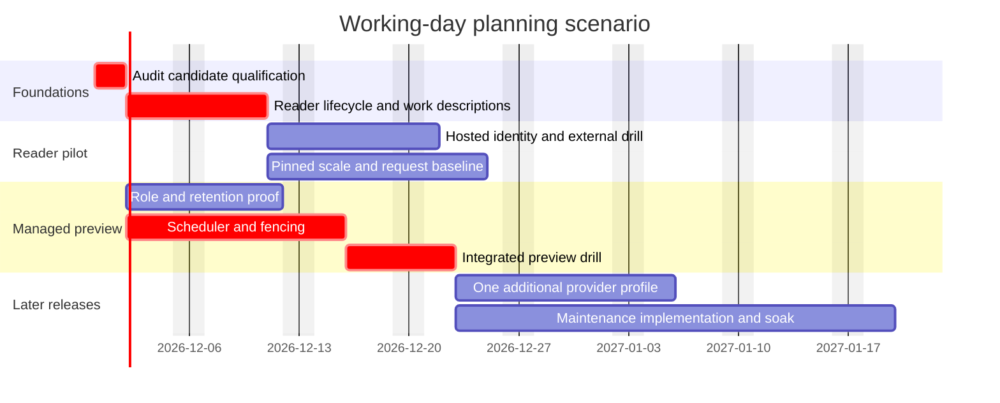
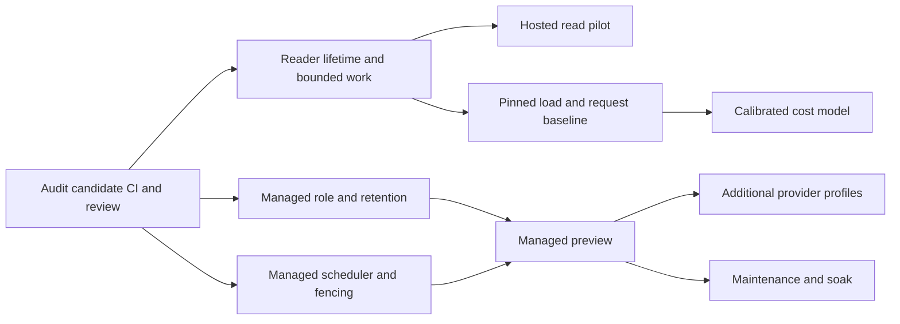

# Foundation audit and delivery schedule

Reviewed on 2026-11-27. The public integration branch was
`fee55cb83e4e0ba9d39f2210ea9995442ed755cb` and the downstream main branch
was `9b5ed0909198c2aa7e6d105865ebbde897a13fda`. The downstream release
lock names public `c104bd72f9058215ce5018f90c7a9d188aa8974a`. Later
downstream lock changes visible on a development branch require their own
release evidence. The merged public candidate passed native and Rust CI.
The downstream lock has an independent local routed TLS receipt and a
passing downstream contract run. [Public CI](https://github.com/anvai-labs/pgdatalake/actions/runs/45945609368) ·
[Downstream lock and evidence](https://github.com/anvai-labs/anvailake/pull/43)

The managed SQL cut, metadata COUNT shortcut and foreground publication
flush landed as integration commits `510a6dc94d5`, `291b5556185` and
`0c01d0cb213`. Some historical PR records were closed after their content
landed on the integration branch. #97 added relation sizing, sampling,
row-group pruning and diagnostic cache controls. #98 added telemetry
policy coverage. Review numbers in commit subjects and GitHub PR numbers
reflect different sequences in this history.

## Milestones and specification conformance

| Milestone and specification coverage | Observed implementation and progress | Missing acceptance or work |
| --- | --- | --- |
| **M0 Build and boundaries** · 00, 01, 10, 11 and 12 | **Complete for the foundation.** C assertion build, stock PGXS package, Rust CI and a shared C source guard. The typed C/Rust batch boundary supports both packages. Fork-only TableAM grammar and SQL remain separately qualified. | Maintain fresh-install and upgrade receipts from every supported predecessor. Verify signed release artifact provenance before a hosted rollout. |
| **M1 Published reads** · 02–06, 09, 13, 14 and modules 01, 02, 06 | **Local pilot qualified.** Stock PG19.0 reads pinned Iceberg v2 with Lakekeeper and S3-compatible storage. Stock CI compares to Trino through position deletes and schema-only restore. Fork and Rust fixtures cover more combinations, including v3 DV reads. The stock package is serial. | Apply this audit's cache authorization and planning repairs. Establish shared FDW error and cancellation cleanup, per-execution resource bounds and supported delete/schema combinations at the chosen release SHA. Run the hosted isolation and external TLS gate on the selected deployment. |
| **M2 Managed append and COW** · 07, 15, 17, 18 and modules 03–05 | **Core join qualified on the fixture.** PostgreSQL WAL-backed capture, exact send admission, one-shot dispatch and lookup-only recovery survive the reply-loss drill. Bound scans serve the compatible cut and retain it on rescan. The fixture covers held RR and RC cases. Eligible bound COUNT and typed foreground flush landed. Direct COW has a separately qualified profile. | Complete effective-role admission, supported portal retention, production scheduler and provider credential lifecycle. Establish backlog and restart SLOs, promoted-primary recovery, and authorized user-facing receipts. Keep write-mode qualifications specific to each path. |
| **M3 Semantics, interoperability and governed reads** · 05–07, 09, 14, 16 and modules 06c, 09, 09a | **Partial.** Exact pins, prepared-execution refresh, time-travel deparse and restore exist. Local scan and publication cases qualify parts of the isolation contract. Governed scope and result-reuse checks have contract fixtures. | Establish supported isolation, mixed-delete and evolution matrices. Add each production catalog, ADLS and GCS transport with independent identity and cancellation tests. Prove one live governed row and column policy before BI reuse. |
| **M4 Maintenance, scalability and observability** · 08, 10, 15, 16, 19 and modules 02a, 08 | **Partial.** Query, table and column telemetry, cache counters, conditional pruning, sampling and two correlated-aggregate rewrites exist. The performance runner can retain DNF results. Local read-node qualification reached four pods under controlled workloads. | Close cancellation and memory accounting, retention-aware expiry and compaction, telemetry attribution and ingest pressure. Qualify the complete pinned comparison and the seven-day mixed-load soak. Fleet capacity needs sustained load with useful completion and cost. |
| **M5 Additional integrations** · 11, 12, 14 and modules 07, 09a, 10 | **Design and backlog.** Heap CDC and marketplace bindings have module contracts. V3 DV consumption has fixture evidence. | Verify consumer checkpoints, supported V3 writes, engine boundaries and marketplace artifact promotion on their own profiles. Order proposals after the preceding correctness and capacity work. |

The earlier implementation review and reassessment retain evidence about
their historical baselines. Use this matrix and the module specifications
for current scope. Keep the module acceptance cases and their receipts
linked to the runtime revision. [Original review](13-implementation-review.md) ·
[Historical reassessment](16-release-reassessment-and-scale.md) ·
[Owners and integration contracts](modules/README.md)

## Findings and implementation order

| Priority | Code or specification finding | Disposition and test |
| --- | --- | --- |
| **P0 Object authorization for cached bytes** | Imports and plans supply storage scope, but endpoint and bucket alone cannot represent a provider's access decision. The baseline served warm bytes from a fresh handle after the loopback provider switched to denying fresh reads. Two fills for one key also double-charged capacity, evicting a valid resident entry. | **Fixed in this pass.** Network cache reuse follows an open handle, including clones. A duplicate key gets one resident charge, and large entries skip the extra copy. Verify provider denial for a whole object and range, valid clone hits and exact byte accounting. [Scope](modules/06b-scoped-read-handoff.md#remote-byte-cache-authorization) · [Cache policy](15-staged-writes-and-caching.md#62-layer-1-immutable-bytes-block-cache-the-big-win-and-the-safe-one) |
| **P1 FDW planning authority and outage behavior** | The recent sizing path made origin I/O the default, cached estimates and failures by relation OID for the session, and used a full scan constructor. An explain-only plan also opened its executor session. The baseline plain EXPLAIN failed with a disconnected catalog. Backend-lifetime storage of options retained temporary credential allocations. | **Fixed in this pass.** Default FDW planning uses catalog estimates. Plain EXPLAIN skips scan startup. Operator remote estimation is explicit, checks the effective role, preserves the requested pin and bounds intermediate lifetimes. Only expected connection and missing-mapping errors fall back. The cache switch applies immediately to upper COUNT as well as ordinary scans. [Estimate contract](19-query-shape-taxonomy-and-cost-model.md#65-l1-seam--planner-visible-foreign-table-cardinality-landed-2026-11-26) |
| **P1 FDW lifecycle and parallel execution** | Ordinary FDW allocates native resources before row demand and closes them in EndForeignScan. Readiness for cancellation and native error recovery needs proof across initialization, iteration and abort. Fork workers get a snapshot number and independently assemble tasks before and during pin reconciliation. | **Next reader slice.** Register native ownership with executor lifetime and add cancel/error injection. Move work authorization and pinning into one shared immutable description with an explicit empty pin. Prove zero additional origin resolution on rewind and identical task coverage across workers after a ref movement. [Reader ownership](modules/02-iceberg-reader.md) |
| **P1 Managed SQL identity and retention** | Admission is relation and invoker scoped at TableAM scan startup. The current callback lacks the effective permission identity for redirected RTEs and the visible cut needs object retention through portal lifetime. Existing positioned proofs cover staged append test cases. | **Next managed slice.** Use an executor-owned context carrying the checked role and grant generation. Qualify a retained object horizon paired with the original executor snapshot. Cover redirected identity, revoked mapping, underlying expiry before output and portal lifetime under concurrent removal. [Managed visibility](modules/03-managed-visibility.md#sql-executor-acceptance) |
| **P1 Durable scheduler and promotion** | The one-shot publication and foreground flush prove separate seams. Retiring credentials, scheduler admission, wakeup/backlog limits and one-primary promotion need joined tests. | **In progress by prerequisites.** Connect discovery to bounded oldest-due scheduling, keep unresolved attempts lookup-only, and prove publisher fencing and WAL floors on replacement. Track oldest confirmed commit age and retained-byte growth during an outage. [Scoped send](modules/04b-scoped-send-admission.md#discovery-and-dispatch) |
| **P2 Cost attribution and scalable byte reuse** | Global counter deltas taken across a scan can include sibling scans in the same backend. The byte cache scans its map to select a victim and charges payload bytes. Sampled ANALYZE estimates can be biased on uneven file distributions. | **Pending.** Attribute request kinds and bytes to the owning execution. Measure map overhead, eviction cost, decoded RSS and blocked I/O. Reuse provider clients inside the authorized scan, then qualify skewed sampling and refresh. Audit cache eviction alternatives only after those measurements. [I/O measurements](modules/08b-io-cost.md) · [Sampling](19-query-shape-taxonomy-and-cost-model.md#65-l1-seam--planner-visible-foreign-table-cardinality-landed-2026-11-26) |
| **P2 Analytics and broader transport profiles** | q1 and q6 have targeted grouped-rewrite results. q4 repeats fact scans and materializes large CTE join inputs. Current measurements span different hardware and the earlier cache and estimate policies. | **In progress with incomplete performance receipts.** Rebaseline exact-pin results and request costs under the serving defaults before choosing scan reuse or publishing speed claims. Run parity across predicates, deletes, collations and row groups. Qualify each cloud profile after identity and retention gates. [Measurement ladder](19-query-shape-taxonomy-and-cost-model.md) · [Cloud profiles](modules/09-cloud-profiles.md) |

## Audit candidate verification

| Test | Observed result |
| --- | --- |
| Rust cache regressions | The baseline returned warm bytes for the freshly opened client and evicted one of two keys that should fit. The candidate observed four provider requests, two authorized clone hits and seven fetched bytes, and kept both resident keys. The full Rust library run passed 177 tests with one manual benchmark ignored. Clippy and formatting passed. |
| Native PostgreSQL | The baseline plain FDW EXPLAIN failed against a disconnected catalog. The candidate returned the local estimate of 1,000 and a normal SELECT still failed with `08000`. On 5,000 live rows, operator metadata mode estimated 5,000, the clamp returned the local estimate, and an ordinary role received `42501` for the operator setting. The assertion build passed 243 upstream and 12 Lakehouse SQL groups. |
| Cache metrics and ANALYZE | Two identical statements returned the same sum while opening separate authorized handles. The fixture recorded 12 misses and 30,606 fetched bytes in total. With the cache switch off, upper COUNT returned the expected 2,000 rows and zero cache counters. ANALYZE estimated 715 rows for the 5,000-row selectivity fixture and 21,680 for its 150,000-row control. |
| Stock PG19.0 and Trino | The stock build and restore agreed on `[10,20,20,30]` at `618799143300911571` and `[10,20,30]` at `1850073755659479158`. COUNT matched both the delete-free fast path and the delete-bearing fallback. Scoped SQL returned no rows on provider denial and made zero origin requests after SQL mapping revocation. |
| Managed TableAM | The bound SQL drill reported counts `[1,2,3]` across its cuts, one publication POST and zero catalog resolutions on rewind. The rotated-scope consistency error was `55000` with zero origin requests. The fixture exercised the opt-in extension upgrades. The fork's packaged fresh-install default remains 1.6 and the opt-in migrations reach 1.25. |
| Contract and documentation | Seven contract-vector tests and nine shared-source guard cases passed. Both Mermaid charts rendered successfully. |

These are local tests against a disposable Lakekeeper, SeaweedFS and Trino
stack. Published performance results still need an exact-candidate
baseline under the corrected authorization and estimate policies.

## Gantt planning view

Durations below are planning estimates in working days, starting on
2026-11-30 for illustration. They assume two engineers can work on reader
and publisher foundations concurrently, the local fixture stack remains
available, and a hosted test environment is approved before the external
drill. Hosted access and production SLOs have no committed date. The
analytics baseline and provider-specific releases require actual capacity
and credentials.

## PERT dependencies and ETA ranges

| Outcome | Estimated work after predecessors | Completion evidence |
| --- | --- | --- |
| Review and qualify the audit candidate | 1–3 working days | Red and fixed controls, assertion build, stock build, CI and independent review |
| Reader execution and local release gate | 4–12 working days | Abort and rescan cleanup, one shared work description, pinned serial/parallel parity, bounded bytes and requests |
| Hosted read pilot | 4–15 working days after reader qualification and approved access | Proven origin denial, stock artifact identity, granted client network and external TLS, connection rotation and cancellation |
| Managed role and retention | 4–16 working days | Current and effective access checks, consistent cut through portal rewind and enforced retention |
| Managed scheduling and promotion | 5–20 working days | Wakeup, backlog and retry evidence, provider issuance and expiry, hard fence and promotion |
| Managed append preview | 3–8 working days after both managed predecessors | One accepted POST under faults, reader parity and measured age and backlog under sustained inserts |
| Calibrated analytics and fleet sizing | 6–20 working days after bounded reader work | Exact-pinned result digests, independent request counters, p95/p99 with sample counts and goodput and cost at each capacity step |
| Additional providers and production maintenance | 7–15 working days per authorized provider. Maintenance is estimated at 10–20 working days plus its seven-day soak | Live credentials, storage semantics, retention and externally read publication receipts |

The first release paths are independent after the audit. The hosted
reader path takes about 16 working days in the illustrated schedule. The
managed preview has about 17 working days of serial dependencies under
the stated parallel staffing assumption. External qualification and a
failed acceptance test can extend either path. The model fit depends on
complete comparable measurements. [Core release gates](modules/08a-core-release-gates.md) ·
[Downstream artifact contract](modules/10-downstream-handoff.md)
